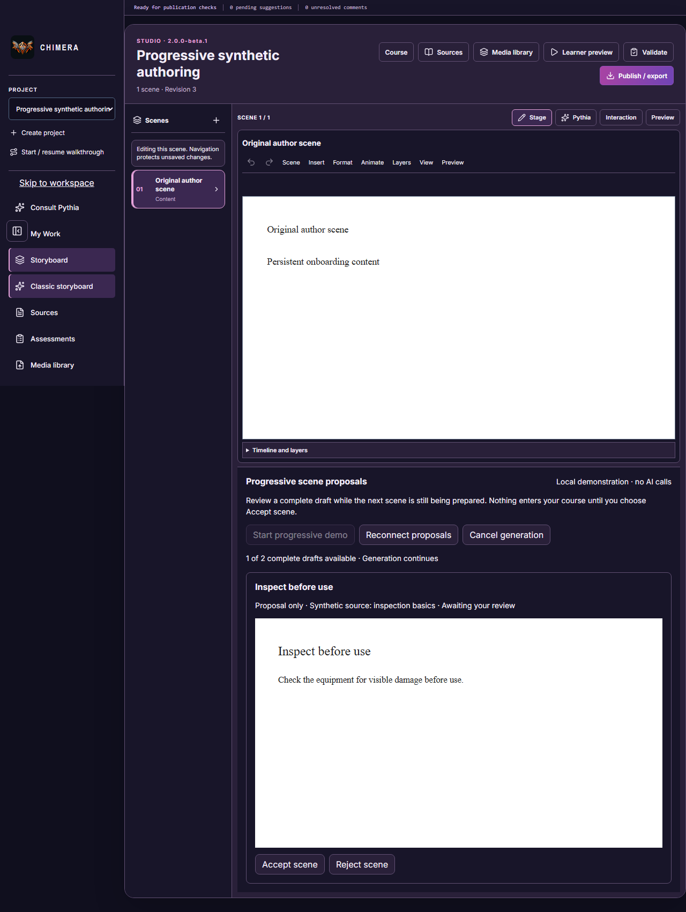

# Issue #43: deterministic progressive scene proposals

This is the B1 no-billing vertical slice. It is not a live Pythia streaming claim.
Work is isolated in `C:\inetpub\Chimera2-progressive`, branch
`feature/chimera2-progressive-authoring`, starting at `1492263` above exact Beta
`9c35f2b853cc42b7ab21c9ce11c70b171330558f`. The worktree was clean before editing;
the original `C:\inetpub\Chimera2` checkout, branch, edits and checkpoint are retained.

## Actual upstream contract findings (B0)

Inspected Chimera's `enhancement_jobs.py`, `pythia_talk.py`, `pythia_hosted.py`,
Studio state, existing Pydantic scene/question models and revision-checked storage:

- Engine adapter: submits one enhancement task, polls task status, waits for
  `awaiting_review`, retrieves and validates one artifact, then returns proposals.
- Local MCP bridge: waits on `Popen.communicate`, parses one JSON envelope and
  returns its completed result. It is not a component stream.
- Hosted drafting: POSTs `/authoring/drafts`, polls `/authoring/operations/<id>`,
  waits for `completed` and verifies `result_sha256` before returning the result.
- Existing enhancement runner calls `provider.generate`, validates the returned
  proposals and only then saves them. Its progress messages are job status,
  not independently usable generated scenes.
- Read-only inspection of the local Pythia checkout (`C:\inetpub\Pythia`, HEAD
  `3b0e3420c389af014ede2d38f85143432cfb6ef6`) corroborates the Engine path:
  `service/execution.py` builds a full artifact, validates it, stores it, and then
  advances to `awaiting_review`. `service/app.py` serves JSON task/artifact reads.
  That checkout has unrelated local changes. This is inspected-source evidence,
  not an exact-commit or deployed Engine qualification.

No verified incremental scene-result interface exists in these inspected consumer
contracts. No live provider was invoked. B2 needs a real upstream per-component
contract or separately generated/validated components; splitting a completed batch
into delayed events would not establish true generation streaming.

## Implemented behavior

The explicit local fixture producer constructs and validates scene 1, persists its
`component.ready` event, and only afterwards constructs scene 2. A cancellable
ten-second interval lets a reviewer inspect/accept the first scene while the job
is still running. It never calls a provider or consumes AI budget.

This supports the charter's inspectable, selectively accepted Pythia relationship
and familiar authoring. The Studio panel reuses `SceneSurface`; acceptance creates
an existing `Scene` with the existing native layout and revision/history storage.
There is no second canonical content model or changed classic authoring flow.

- `DraftScene` strictly narrows the existing `SceneCreate` to complete native
  content scenes, then validates against `Scene`. Assessments/PPTX alignment remain B3.
- Version-1 events bind job/project, immutable source revision, expected current
  project revision, component identity, sequence, status, provenance and order.
- Atomic proposal/event documents live under each project's `progressive-proposals`,
  separate from `storyboard.json`. Eight jobs/project and 64 events/job bound the
  local fixture store; generation never silently evicts evidence or starts a new job.
- Read-only cursor polling every 500 ms is the bounded first-slice transport.
  No SSE/production-proxy compatibility is claimed. Polling does not advance the
  producer. Requests abort on unmount; an error stops polling until explicit reconnect.
- Reconnect/reload replays durable events; ordered merging deduplicates deliveries
  and rejects scope changes, gaps, inconsistent duplicates or incomplete scenes.
- Author acceptance is explicit, requires `If-Match`, goes through the existing
  unsaved-edit guard, and refuses unrelated saved-revision changes. Only the job's
  own accepted additions advance its expected project revision. Rejection changes
  proposal state only. Stable inserted scene IDs recover an interrupted accept
  without reinsertion or overwriting subsequent author edits.
- Permission checks apply at submit, each producer step, replay, cancel and apply;
  another actor cannot access the job. Events are returned with `Cache-Control: no-store`.
- Cancellation stops further delivery and prevents acceptance from the cancelled job.
  Component validation failures are withheld individually. A process restart marks
  unfinished jobs failed without reissuing generation; earlier events remain replayable.

## Run and review locally

Both gates are default-off: backend `CHIMERA_PROGRESSIVE_DEMO=true` and frontend
`VITE_CHIMERA_PROGRESSIVE_DEMO_ENABLED=true` (plus the existing Studio flag).
The backend additionally requires a single-user installation; team installations
cannot enable this demonstration merely by setting the flag.

Automated browser harness, from this worktree:

```powershell
$env:CHIMERA_TEST_PYTHON='C:\inetpub\Chimera2\backend\.venv\Scripts\python.exe'
npx playwright test --config playwright.progressive.config.cjs
```

It uses dedicated loopback ports 8031/5191 and a new synthetic workspace on each
run. It strips inherited provider/hosted configuration and authors its course via
the UI rather than API-seeding. It does not touch existing authoring workspaces.

For a manual demo, run `node tests/progressive/start-backend.cjs` in one terminal
with `CHIMERA_TEST_PYTHON` set as above. In a second terminal set
`VITE_CHIMERA_PROGRESSIVE_DEMO_ENABLED=true` and `VITE_CHIMERA_STUDIO_ENABLED=true`, then run
`node frontend/node_modules/vite/bin/vite.js --config tests/progressive/vite.config.mjs`.
Open `http://127.0.0.1:5191`, create a synthetic course/scene, enter Studio, and:

1. Choose **Start progressive demo**. Inspect the first scene while the status says
   generation continues. Verify the canonical Scenes list is unchanged.
2. Choose **Reconnect proposals**; the same draft appears once. Accept the first
   draft to add it to the course, or reject it to leave the course untouched.
3. Start another demonstration and cancel it. Reconnect/reload; its earlier draft
   remains visible with acceptance disabled. Try accepting with an unsaved edit:
   the existing Save/Discard/Keep editing dialog protects the draft.

Machine evidence and founder acceptance are separate. Automated synthetic UI checks
do not establish ordinary-author usability or full multi-source learning acceptance.

## Validation evidence

- Full backend regression run: **708 tests run, 72 skipped, no failures**. The
  final targeted progressive suite additionally passes **12 tests**, including
  the final API conflict/cache and active-worker cancellation checks.
- Client replay reducer: **2 tests passed** (out-of-order replay/deduplication,
  wrong scope, inconsistent duplicate, missing sequence and incomplete scene).
- Frontend TypeScript/production build and `git diff --check`: passed. The build
  retains its existing large-chunk warning; this is not a performance qualification.
- Chromium and Firefox passed all four UI cases. WebKit passed early rendering,
  reconnect/reload/cancellation and unsaved-edit protection; its layout check was
  passed in a targeted rerun after correcting the breakpoint helper race described below.
- Layout checks cover 320, 768, 1024 and 1440 CSS pixels with axe on the proposal
  panel. Existing authoring is exercised through real UI course/scene creation.
  This is scoped automated accessibility evidence, not screen-reader acceptance.

Earlier diagnostics are retained honestly: initial scene counts included the
navigation's Add button (test selector corrected), and the reload helper initially
kept an empty project-list fixture (fixture removed before reload). The first
cross-browser run hit 30-second budgets during the intentional producer pause.
The producer now bounds elapsed pause time and UI tests allow setup plus review.
One subsequent WebKit layout test raced the desktop/mobile menu toggle; it now
waits for the automatic breakpoint state without clicking that disappearing control.
No production settings or unrelated navigation code were changed to pass the tests.



[320-pixel proposal capture](qualification/progressive-proposal-320.png).

## Next blocker

B2 requires verified upstream partial-component output and a versioned mapping to
these validated proposal events. Real Pythia streaming, uploaded PPTX identity/order,
source-grounded assessment insertion, team/hosted qualification and downstream
SCORM/QTI acceptance of those future sources remain NOT TESTED by this slice.
No deployment files, Hostinger, production, credentials or paid generation are changed.
