# Chimera user guide

Process-based instructions for the restored local authoring interface. Prepared 2026-09-30. Source: `ce70067` plus recovered stash `fe48af8` (Export Enhancement -- Pass 1). See the [recovery record](export-enhancement-recovery.md).

## How to use this guide

Each task has its own **Step / Action / Result / Control image** table. Click a control image to open the full-size screenshot. Screenshots show the real Chimera interface in Light appearance, using an isolated demonstration project. Course names and sample content will differ in your workspace. Browser file pickers, download prompts, and confirmation dialogs vary by browser and operating system; screenshots show the Chimera controls that open them.

The source has changed since the original capability review: Word export, reference upload, enhancement submission, generated-media candidate review, comments, and portable backups now have interface controls. Their presence does not certify a configured AI provider or compatibility with every LMS. Example proposals, candidates, and job statuses in these images are documentation fixtures; no live AI request was made for this guide.

**Prerequisite:** Start the backend and frontend using the [README setup instructions](../README.md#start-locally), then open `http://localhost:5173`. Keep both services running while authoring. LibreOffice is needed for rendered PowerPoint slide previews. AI tasks additionally require server-side provider configuration; there is no provider settings form in the current UI.

**Working convention:** Select the intended project and scene before editing. Use the task's Save/Create/Accept control and wait for completion. Merely typing into a form does not save it. If a revision-conflict message appears, reload the project, inspect the latest values, and reapply the intended change. Do not assume unsaved form text will survive a reload.

Optional interactive help is available under **Review tools ? Guided review ? All functionality walkthroughs**. Search the catalog and start the task you want to practice. The sidebar resumes your last selected walkthrough. Action steps wait for confirmed saves/downloads; review steps use Next. Escape pauses without clearing an open draft. Progress is browser-local and separate for each task/project; completing a walkthrough does not certify readiness. Restore/deletion confirmations and provider submissions remain your decisions.

## Processes

1. [Manage projects and workspace](#1-manage-projects-and-workspace)
2. [Import and author scenes](#2-import-and-author-scenes)
3. [Manage templates](#3-manage-templates)
4. [Manage imported media and accessibility](#4-manage-imported-media-and-accessibility)
5. [Author assessments](#5-author-assessments)
6. [Import references and request enhancement](#6-import-references-and-request-enhancement)
7. [Review enhancement proposals](#7-review-enhancement-proposals)
8. [Generate and approve media](#8-generate-and-approve-media)
9. [Play and comment on the storyboard](#9-play-and-comment-on-the-storyboard)
10. [Validate course readiness](#10-validate-course-readiness)
11. [Export course deliverables](#11-export-course-deliverables)
12. [Back up and restore](#12-back-up-and-restore)
13. [Review project health](#13-review-project-health)

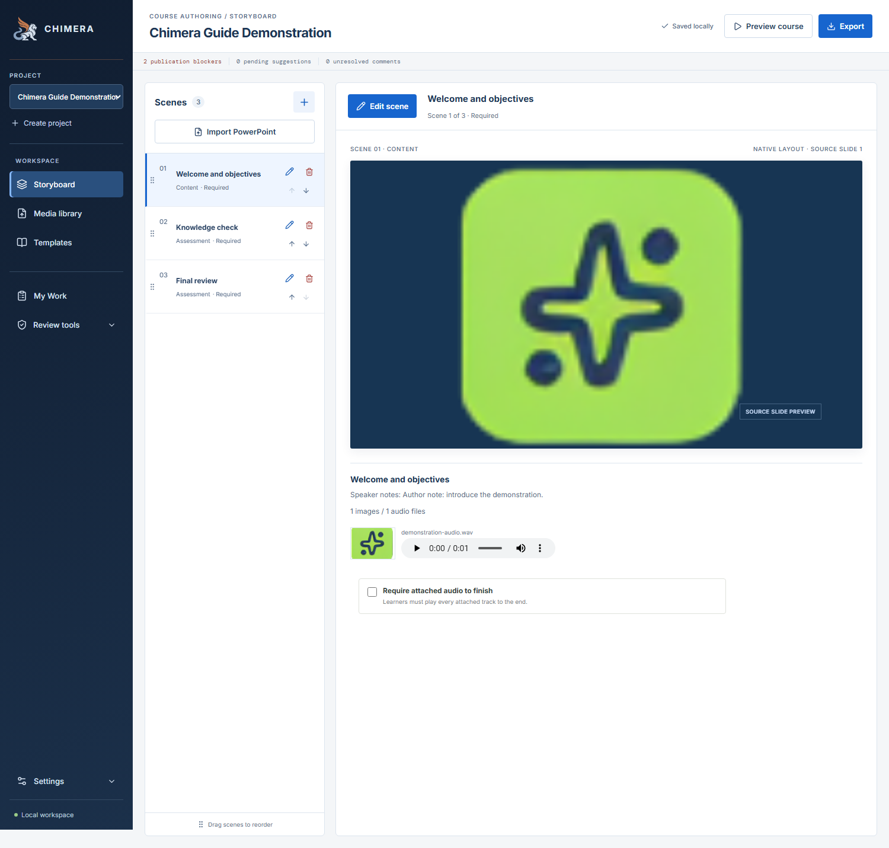

## 1. Manage projects and workspace

### Create a project

| Step | Action | Result | Control image |
| --- | --- | --- | --- |
| 1 | Click **Create project** in the sidebar. | The course-name dialog opens. | <a href="user-guide/images/project-controls.png">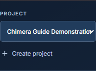</a> |
| 2 | Enter a **Course name**, then click **Create project**. | A new empty project becomes active. | <a href="user-guide/images/create-project.png">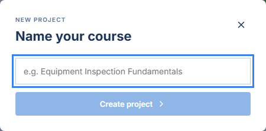</a> |

### Switch projects

| Step | Action | Result | Control image |
| --- | --- | --- | --- |
| 1 | Open the **PROJECT** selector and choose the desired course. | The selected storyboard and project media load. |  |
| 2 | Check the course title above the workspace before continuing. | Subsequent edits apply to the intended project. |  |

### Change appearance

| Step | Action | Result | Control image |
| --- | --- | --- | --- |
| 1 | Open **Settings** at the bottom of the sidebar. | Appearance options become available. |  |
| 2 | Choose **Light**, **Dark**, or **System**. | The preference is applied and remembered in this browser. | <a href="user-guide/images/appearance.png">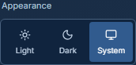</a> |

### Follow the guided workflow

For an interactive first-scene walkthrough, choose **Start / resume walkthrough** in the sidebar or in Guided review. The guide highlights the relevant control and advances after a confirmed project/scene save. Existing projects begin at scene creation. **Escape** or **Pause guide** hides the guide without discarding the open form; use **Resume walkthrough** inside that form to continue. Skipping a step ends the walkthrough without marking it complete. Restarting creates new practice content; it does not reset the project. See the [implementation and verification record](onboarding-implementation.md).

| Step | Action | Result | Control image |
| --- | --- | --- | --- |
| 1 | Expand **Review tools** and click **Guided review**. | The Golden Path checklist opens. | <a href="user-guide/images/review-tools.png">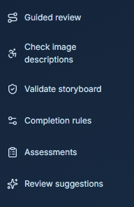</a> |
| 2 | Read a step and use its action, such as **Review scenes**, **Open media library**, or **Run validation**. | Chimera opens that task; unavailable steps depend on project content. | <a href="user-guide/images/guided-review.png">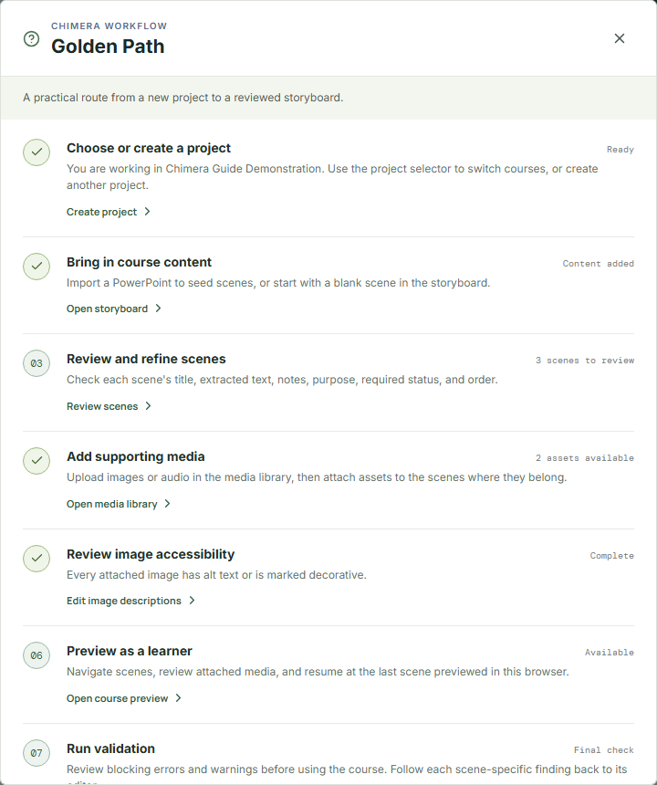</a> |

## 2. Import and author scenes

Scene creation and edits are saved locally. History snapshots are maintained by the application; there is no general history browser or restore-history button documented in this interface.

### Import a PowerPoint storyboard

Importing another deck updates the project from that deck. Download a portable backup first if the current authored work must be retained independently. Captured animation XML does not guarantee equivalent playback.

| Step | Action | Result | Control image |
| --- | --- | --- | --- |
| 1 | Select the project, then click **Import PowerPoint** above the scene list. | The file picker opens. |  <a href="user-guide/images/scene-sequence.png">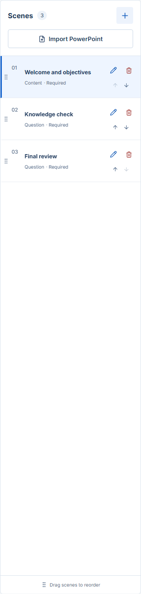</a> |
| 2 | Choose a `.pptx` file and wait for processing. | Scenes, extracted content, and supported media appear; slide rendering may report a LibreOffice warning. |  |
| 3 | Select each imported scene and inspect its text, notes, media, and preview. | You can identify extraction or rendering issues before publishing. |  |

### Create a scene

| Step | Action | Result | Control image |
| --- | --- | --- | --- |
| 1 | Click the **+** control labeled **Add scene**. | The New scene dialog opens. |  |
| 2 | Enter **Scene title**, select **Scene type** and **Scene layout**, and enter **On-screen text**. Set directions, notes, and **Required scene** as needed. | The new scene is prepared in the form. | <a href="user-guide/images/new-scene.png">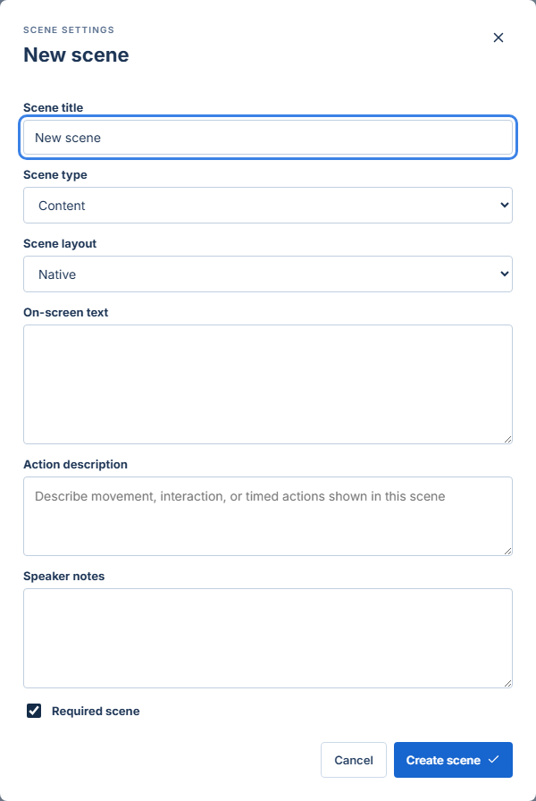</a> |
| 3 | Click **Create scene**. | The scene is appended and saved. |  |

### Edit scene content and settings

On-screen text is learner content. Action descriptions and speaker notes are authoring material. Inspect playback and exports rather than assuming changes to extracted text redraw an imported slide image.

| Step | Action | Result | Control image |
| --- | --- | --- | --- |
| 1 | Select a scene, then click **Edit scene** or its pencil icon. | The scene editor opens. |   |
| 2 | Update the title, type, layout, on-screen text, action description, speaker notes, or required status. | The form contains your intended edits. | <a href="user-guide/images/scene-editor.png">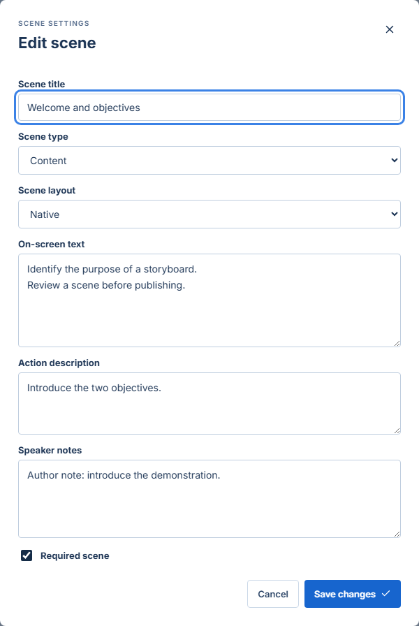</a> |
| 3 | Click **Save changes**; use **Cancel** to discard form edits. | Saved changes update the storyboard and its revision. |  |

### Edit text and images on the canvas

Select the scene and choose **Edit canvas** beside **Edit scene**. The canvas editor saves a separate editable layout; it does not paint over the flattened PowerPoint preview.

1. For an older imported scene, choose **Extract source layout** to recover positions and inherited artwork from the retained PPTX. This preserves scene IDs, notes, questions, review threads, existing assets, and authored text. The extracted layout remains inactive until **Save scene**. Cancelling keeps the extracted data but does not change playback.
2. Double-click a text box, or focus it and press Enter, to edit its text directly. The **Text** field also edits the selected box. Drag boxes to move them, use resize handles, or enter exact position and size in the properties panel. Arrow keys move the focused element; Shift changes the step from one to ten slide-space units.
3. Drag an **Attached images** thumbnail onto the canvas. Clicking the thumbnail adds it without dragging. The media-library selector can add other project images. Selecting an image exposes replacement and crop-reset controls.
4. Use **Layers** to select overlapping or inherited content. Master and layout artwork starts locked; unlock it before editing. Toolbar controls add text, undo/redo, duplicate/delete elements, and change stacking order. Text properties include size, color, typeface, alignment, bold, and italic.
5. Choose a background color or project image in the properties panel. Imported picture backgrounds and supported inherited master/layout images are available as project assets. **Source slide**, when available, temporarily shows the original flattened rendering for comparison.
6. Choose **Save scene**, then check **Preview course**. The saved canvas replaces the source preview in authoring, preview, and both SCORM profiles. **Cancel** discards unsaved canvas changes.

New imports capture editable text/image geometry, rotation, cropping, slide dimensions, inherited graphics, and solid/picture backgrounds. The original preview remains the default until a visual layout is saved. Inspect **Import limitations** before enabling it: charts, SmartArt, shape decorations, gradients, group rotation, mixed text formatting, bullets, and inherited styles may be unsupported or approximated. Original previews and retained PPTX files remain available; this is not full PowerPoint-equivalent editing.

For a scene with an enabled visual layout, edits to **On-screen text** in the original metadata dialog also update the corresponding visual text boxes. The scene title remains the navigation label; use the canvas editor to change a title drawn on the slide.

### Jump directly to another scene

In **Preview course**, open **Contents** and choose a scene by number and title. The list marks the current and visited scenes. Jumping preserves assessment answers and audio-completion state, and only the selected scene becomes visited. Exported SCORM players provide a **Contents** selector with the same scene sequence.

The reviewer form follows Light and Dark appearance for labels, fields, thread text, and controls. Its contrast is qualified in both modes.

### Reorder scenes

| Step | Action | Result | Control image |
| --- | --- | --- | --- |
| 1 | Locate the scene in the scene list. Drag its row to the target position, or use its up/down arrow buttons. | The sequence is changed and saved. |  |
| 2 | Select the moved scene and verify its position. | The course sequence reflects the intended order. |  |

### Delete a scene

Use a portable backup before deletion when you need an accessible recovery copy. History storage does not imply a visible one-click undo control.

| Step | Action | Result | Control image |
| --- | --- | --- | --- |
| 1 | Select the trash icon beside the scene to remove. | A confirmation describes the deletion and relevant consequences. |  |
| 2 | Read the confirmation and confirm only if the correct scene is named; otherwise cancel. | The scene is removed after confirmation; the previous storyboard is retained in history. |  |

## 3. Manage templates

### Upload a scene template

| Step | Action | Result | Control image |
| --- | --- | --- | --- |
| 1 | Choose **Templates** in the sidebar. | The template library opens. |  |
| 2 | Click **Upload PPTX template** and select a `.pptx` file, up to 50 MB. | The uploaded template appears in the library. | <a href="user-guide/images/templates.png">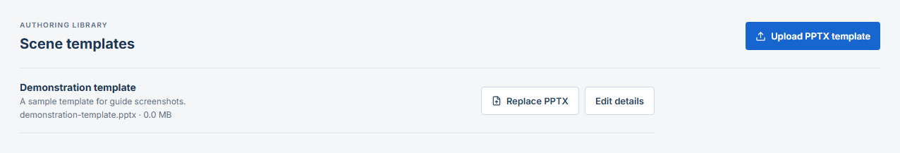</a> |

### Edit template details

| Step | Action | Result | Control image |
| --- | --- | --- | --- |
| 1 | In **Templates**, click **Edit details** for the intended template. | The template editor opens. |  |
| 2 | Change **Template name** and **Description**, then click **Save template**. | The library metadata is updated. | <a href="user-guide/images/template-details.png">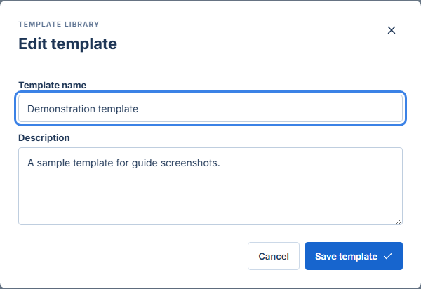</a> |

### Replace a template source deck

| Step | Action | Result | Control image |
| --- | --- | --- | --- |
| 1 | In **Templates**, locate the correct template and click **Replace PPTX**. | The file picker opens for that template. |  |
| 2 | Choose the revised `.pptx` file and wait for completion. | The template source is replaced; inspect affected scenes before publishing. |  |

### Assign a template to a scene

Upload a template first. Assignment is not a guarantee that every PowerPoint effect will be reproduced in playback.

| Step | Action | Result | Control image |
| --- | --- | --- | --- |
| 1 | Open the scene editor and set **Scene layout** to **Template**. | A Template selector appears. |  |
| 2 | Choose a template, then click **Save changes** or **Create scene**. | The scene stores the selected template reference. | <a href="user-guide/images/template-selection.png">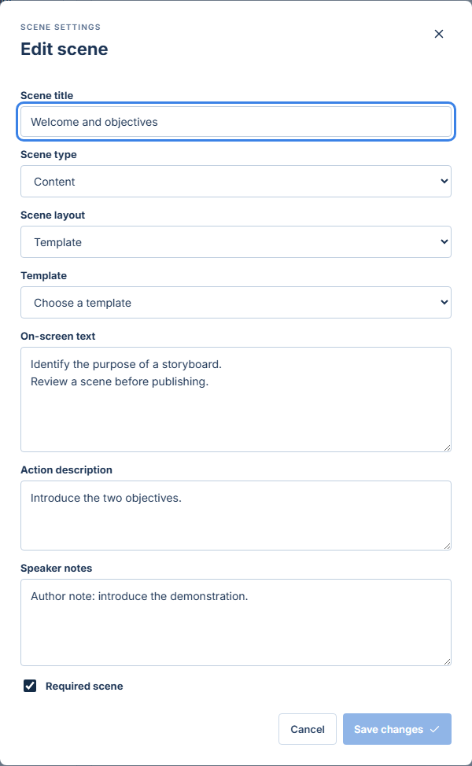</a> |

## 4. Manage imported media and accessibility

The current upload interface accepts images and audio, up to 100 MB per file. Images: JPG, PNG, GIF, WebP. Audio: MP3, M4A, AAC, WAV, OGG. Video import, a shared media library across projects, and explicit course-wide placement are not exposed by these controls.

### Upload external media

| Step | Action | Result | Control image |
| --- | --- | --- | --- |
| 1 | Select the intended scene in **Storyboard**, then open **Media library**. | The media view identifies the selected scene. |   |
| 2 | Click **Upload media** and choose a supported file. | The asset is added to the project library. Upload does not by itself attach it. | <a href="user-guide/images/media-library.png">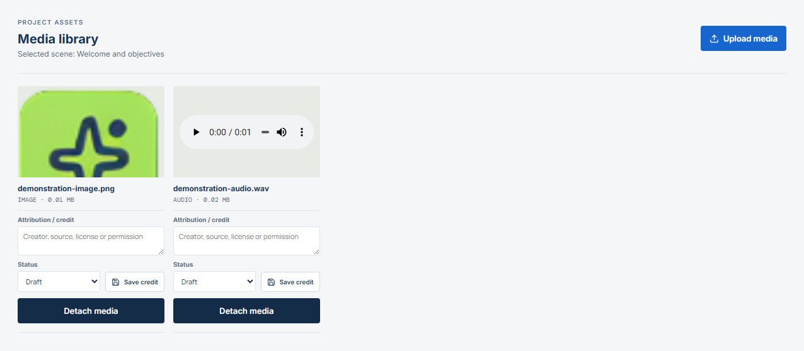</a> |

### Attach or detach scene media

The screenshot shows an attached example and its Detach media button. The same control reads Attach to scene when the asset is not attached.

| Step | Action | Result | Control image |
| --- | --- | --- | --- |
| 1 | Select the target scene in **Storyboard**, return to **Media library**, and locate the asset. | The selected scene determines the attachment target. |   |
| 2 | Click **Attach to scene**. For an attached asset, click **Detach media** to remove the scene association. | The scene reference changes; detaching does not delete the library asset. | <a href="user-guide/images/attach-media.png">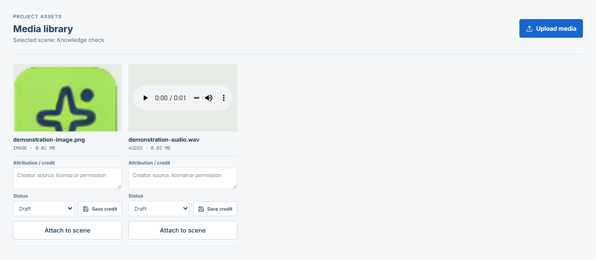</a>  |

### Record media attribution

| Step | Action | Result | Control image |
| --- | --- | --- | --- |
| 1 | In a media card, fill **Attribution / credit** with creator, source, and license or permission information. | Attribution text is prepared. |  |
| 2 | Choose **Draft** while unfinished or **Complete** when verified, then click **Save credit**. | The attribution status is saved. Production validation checks attribution readiness. |  |

### Describe scene images

| Step | Action | Result | Control image |
| --- | --- | --- | --- |
| 1 | Open **Review tools → Check image descriptions**. | Attached images are grouped by scene. |  |
| 2 | Enter **Alternative text** describing the image information, or select **Decorative image** when appropriate. | Each image has a description or explicit decorative designation. | <a href="user-guide/images/image-descriptions.png">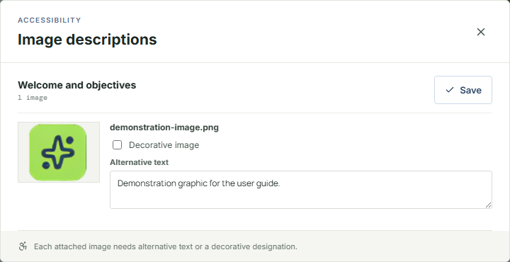</a> |
| 3 | Click **Save** for each scene you edited. | That scene’s accessibility settings are saved. |  |

### Require audio completion

| Step | Action | Result | Control image |
| --- | --- | --- | --- |
| 1 | Attach audio to the scene, then return to its storyboard view. | The required-audio checkbox is available below the scene. |  <a href="user-guide/images/audio-requirement.png">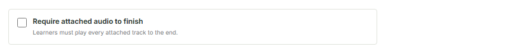</a> |
| 2 | Select **Require attached audio to finish**. | Learners must finish every attached track for that audio requirement. |  |

## 5. Author assessments

Start each assessment task with a scene whose **Scene type** is **Assessment**. Set that type in Edit scene and save. Select **Create question** for a new question or **Edit question** for an existing one. The question editor supports seven types. Changing types replaces the type-specific question structure in the form; save only after checking the new content.

### Open or create an assessment question

| Step | Action | Result | Control image |
| --- | --- | --- | --- |
| 1 | Edit the scene, choose **Assessment** under **Scene type**, and save. | The scene displays the question-authoring section. |  |
| 2 | Click **Create question** or **Edit question** below the canvas. | The question editor opens. | <a href="user-guide/images/assessment-create.png">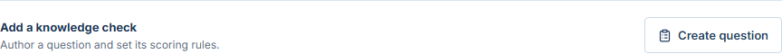</a> <a href="user-guide/images/assessment-launch.png">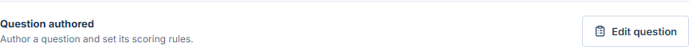</a> |

### Author a single-choice question

| Step | Action | Result | Control image |
| --- | --- | --- | --- |
| 1 | Choose **Multiple choice ? one answer**, enter the **Question prompt** and answer text, and mark exactly one answer as correct. Use **Add answer choice** or the minus buttons as needed. | The question content and correct response are defined. | <a href="user-guide/images/question-single-choice.png">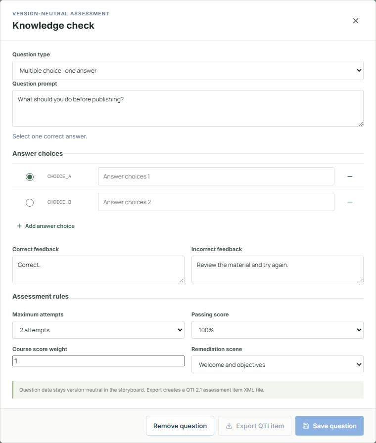</a> |
| 2 | Enter **Correct feedback** and **Incorrect feedback**, then click **Save question**. | The question is saved to the scene. |  <a href="user-guide/images/assessment-actions.png">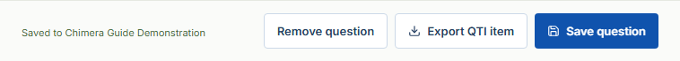</a> |

### Author a multiple-correct question

| Step | Action | Result | Control image |
| --- | --- | --- | --- |
| 1 | Choose **Multiple choice ? multiple answers**, enter the prompt and answer choices, and select the checkbox for every correct answer. | The question content and correct response are defined. | <a href="user-guide/images/question-multiple-response.png">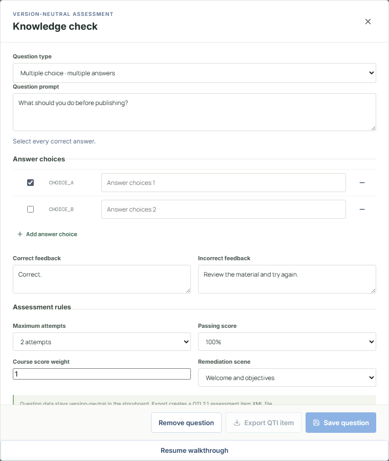</a> |
| 2 | Enter **Correct feedback** and **Incorrect feedback**, then click **Save question**. | The question is saved to the scene. |   |

### Author a true/false question

| Step | Action | Result | Control image |
| --- | --- | --- | --- |
| 1 | Choose **True / False**, enter the statement as the prompt, and select **True** or **False** under Correct answer. | The question content and correct response are defined. | <a href="user-guide/images/question-true-false.png">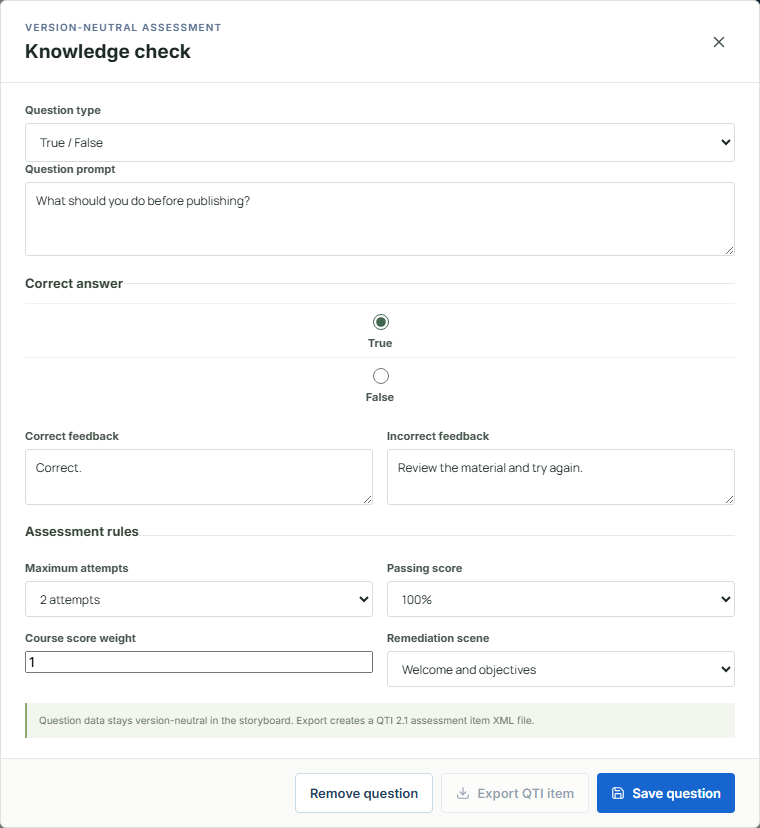</a> |
| 2 | Enter **Correct feedback** and **Incorrect feedback**, then click **Save question**. | The question is saved to the scene. |   |

### Author an ordering question

| Step | Action | Result | Control image |
| --- | --- | --- | --- |
| 1 | Choose **Ordering**, enter the prompt and steps, and use the earlier/later arrows to establish the **Correct sequence**. Use **Add step** as needed. | The question content and correct response are defined. | <a href="user-guide/images/question-ordering.png">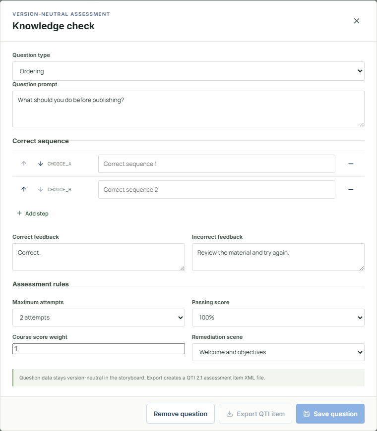</a> |
| 2 | Enter **Correct feedback** and **Incorrect feedback**, then click **Save question**. | The question is saved to the scene. |   |

### Author a drag-and-drop question

| Step | Action | Result | Control image |
| --- | --- | --- | --- |
| 1 | Choose **Drag and drop**, enter the prompt, draggable items, and drop targets, then choose each correct placement. Use distinct targets for the intended matches. | The question content and correct response are defined. | <a href="user-guide/images/question-drag-drop.png">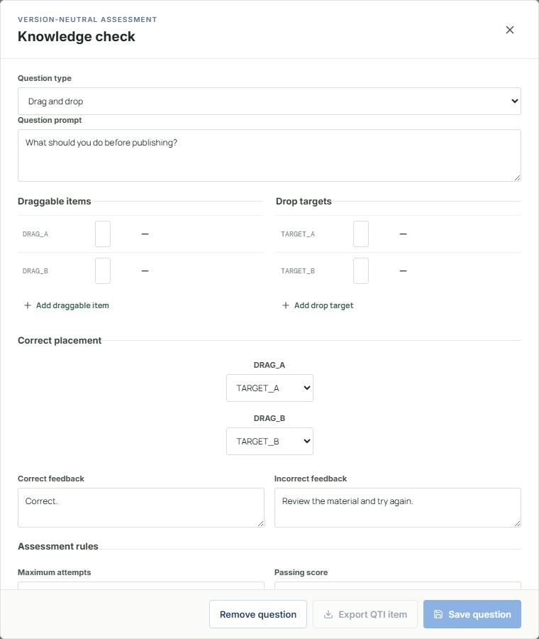</a> |
| 2 | Enter **Correct feedback** and **Incorrect feedback**, then click **Save question**. | The question is saved to the scene. |   |

### Author a matching question

| Step | Action | Result | Control image |
| --- | --- | --- | --- |
| 1 | Choose **Matching**, enter the prompt and left/right items, then select each correct match. | The question content and correct response are defined. | <a href="user-guide/images/question-matching.png">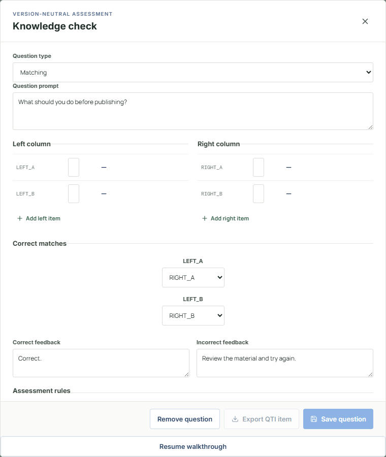</a> |
| 2 | Enter **Correct feedback** and **Incorrect feedback**, then click **Save question**. | The question is saved to the scene. |   |

### Author a short-answer question

| Step | Action | Result | Control image |
| --- | --- | --- | --- |
| 1 | Choose **Short answer**, enter the prompt, and enter one accepted answer per line. Select **Match letter case** only when capitalization must match. | The question content and correct response are defined. | <a href="user-guide/images/question-short-answer.png">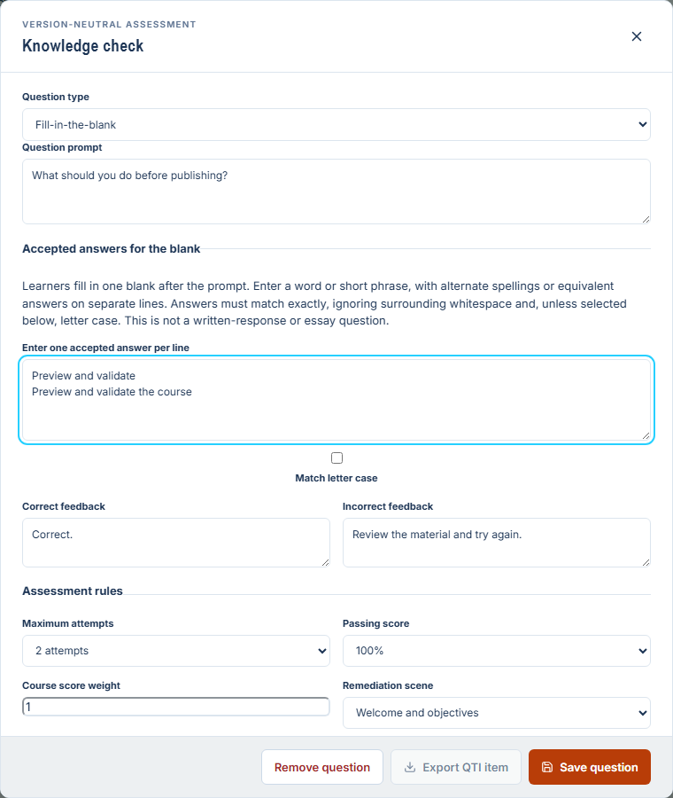</a> |
| 2 | Enter **Correct feedback** and **Incorrect feedback**, then click **Save question**. | The question is saved to the scene. |   |

### Configure question scoring and remediation

Current question scoring is binary: 0% or 100%. Course score weights affect the aggregate course score; they do not create partial credit within a question.

| Step | Action | Result | Control image |
| --- | --- | --- | --- |
| 1 | Open the question editor and scroll to **Assessment rules**. | Question-level settings are visible. | <a href="user-guide/images/assessment-rules.png">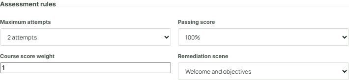</a> |
| 2 | Set **Maximum attempts**, **Passing score**, **Course score weight**, and an optional **Remediation scene**. | Attempts, scoring contribution, and review destination are specified. |  |
| 3 | Click **Save question**. | The question and its rules are saved. |  |

### Remove an assessment question

| Step | Action | Result | Control image |
| --- | --- | --- | --- |
| 1 | Open the existing question and click **Remove question**. | A removal confirmation appears. |  |
| 2 | Confirm removal if intended. | The question is removed from the scene; the scene remains. |  |

### Set course completion rules

| Step | Action | Result | Control image |
| --- | --- | --- | --- |
| 1 | Open **Review tools → Completion rules**. | Course-level scoring controls open. |  |
| 2 | Select **Course passing score** and whether to **Include optional questions in course score**. | The aggregate scoring policy is prepared. | <a href="user-guide/images/completion-rules.png">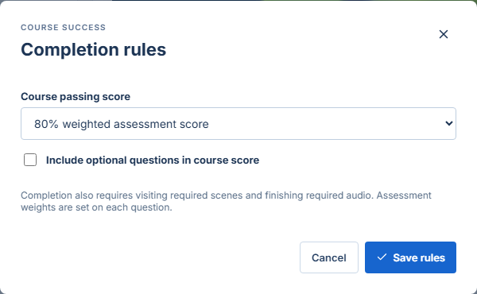</a> |
| 3 | Click **Save rules**. | The policy is saved. Required scene visits and required audio also contribute to completion. |  |

## 6. Import references and request enhancement

AI submission requires an administrator to configure the server-side provider. Without it, Preview submission remains useful, but Submit run is disabled. This guide does not claim that an AI service was contacted or its output verified.

### Import a Study Guide or supporting reference

Failed or incomplete extraction disables selection. The current form does not provide full resource classification, version-management, or scene-mapping editors.

| Step | Action | Result | Control image |
| --- | --- | --- | --- |
| 1 | Open **Review tools → Review suggestions**. | Storyboard suggestions opens with the New enhancement run form. |  |
| 2 | Click **Add reference** and select PDF, DOCX, PPTX, TXT, or MD, up to 25 MB. | Chimera imports the resource and attempts text extraction. | <a href="user-guide/images/enhancement-form.png">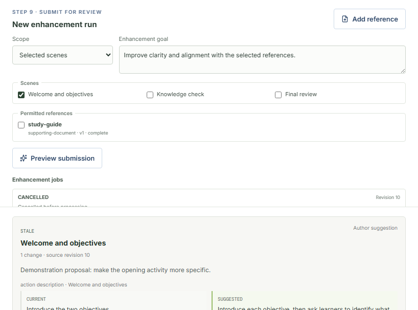</a> |
| 3 | Check the extraction status under **Permitted references**. Select the resource only if extraction is complete. | Selected references become eligible for the enhancement request. |  |

### Select enhancement scope and inspect the submission

| Step | Action | Result | Control image |
| --- | --- | --- | --- |
| 1 | Choose **Whole course** or **Selected scenes** under **Scope**; for selected scenes, check the required scene boxes. | The enhancement target is defined. |  |
| 2 | Enter an **Enhancement goal** and check the **Permitted references** to include. | The run is limited to the chosen content and references. |  |
| 3 | Click **Preview submission**, then expand **Inspect submitted content**. | You can inspect the payload, source revision, counts, estimated input tokens, and any available cost estimate. |  <a href="user-guide/images/submission-preview.png">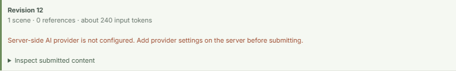</a> |

### Submit an enhancement run

| Step | Action | Result | Control image |
| --- | --- | --- | --- |
| 1 | Complete and inspect the submission preview. Resolve the provider-not-configured message if present. | You know what will be sent and whether submission is available. |  |
| 2 | Click **Submit run** when enabled. | An enhancement job is created; it produces proposals rather than directly applying changes. |  |
| 3 | Review the job status and any reported resource conflicts, then review returned suggestions individually. | You can distinguish completion, failure, and suggestions needing a decision. | <a href="user-guide/images/enhancement-jobs.png">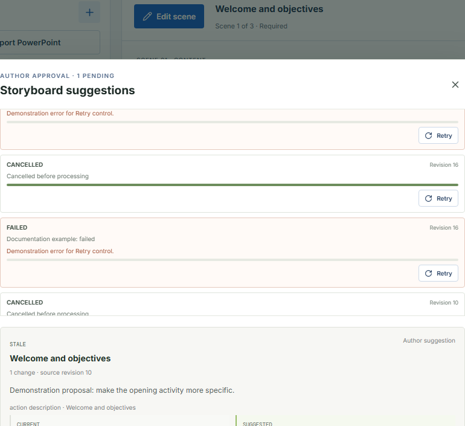</a> <a href="user-guide/images/proposal.png">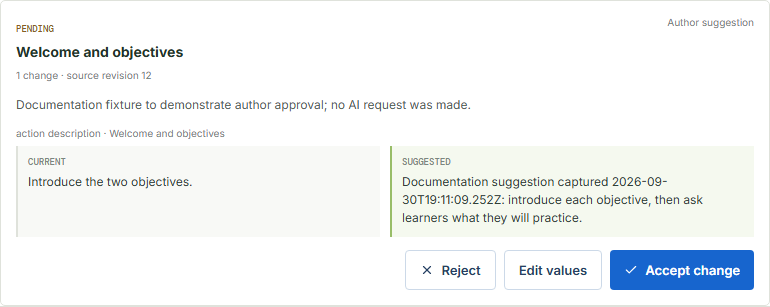</a> |

### Cancel or retry an enhancement job

| Step | Action | Result | Control image |
| --- | --- | --- | --- |
| 1 | In Storyboard suggestions, find the run under **Enhancement jobs**. | Its status and message are visible. |  |
| 2 | Click **Cancel** for a queued/running job, or **Retry** for a failed/cancelled job after addressing the cause. | Cancellation is requested or a retry job is started. Neither action approves proposals. |  |

## 7. Review enhancement proposals

### Accept or reject a suggestion

A proposal can contain multiple related changes. Accept change applies that displayed proposal as a group, so review every included change. A source-backed label is not a substitute for checking the source.

| Step | Action | Result | Control image |
| --- | --- | --- | --- |
| 1 | Open **Review tools → Review suggestions** and locate a pending proposal. | The proposal shows its rationale, source revision, and changes. |   |
| 2 | Compare **Current** and **Suggested** for every included change; inspect citations if provided. | You understand the complete proposal before deciding. |  |
| 3 | Click **Accept change** to apply the proposal, or **Reject** to leave the storyboard unchanged. | The decision is recorded. A stale/conflicting proposal cannot overwrite newer edits. |  |

### Edit a suggestion before accepting

| Step | Action | Result | Control image |
| --- | --- | --- | --- |
| 1 | On a pending proposal, click **Edit values**. | Editable suggested-value fields appear. |  |
| 2 | Revise the suggested values. Structured values are labeled JSON and must remain valid JSON; use **Cancel edit** to discard these form edits. | The displayed proposed content reflects your intended version. | <a href="user-guide/images/proposal-edit.png">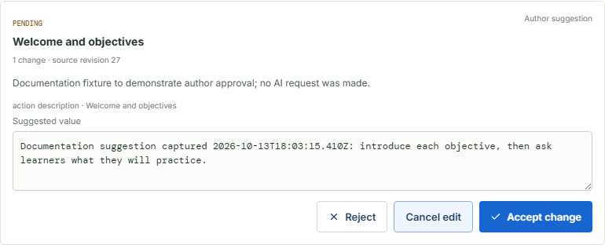</a> |
| 3 | Click **Accept change**. | The edited proposal is applied if valid and current. |  |

### Undo an accepted suggestion

| Step | Action | Result | Control image |
| --- | --- | --- | --- |
| 1 | Locate the accepted proposal and click **Undo acceptance**. | Chimera attempts to restore the captured previous values. | <a href="user-guide/images/proposal-accepted.png">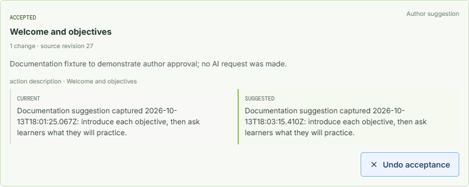</a> |
| 2 | Inspect the resulting scene or any conflict message. | Reversal succeeds only when later changes do not prevent a safe restore. |   |

## 8. Generate and approve media

Select the target scene before opening Media library. AI media generation requires compatible server-side image/audio provider configuration. The current interface does not offer arbitrary canvas positioning, a generation-cost preview, or a full media-job monitor. A candidate’s approval attaches it to its target scene.

### Request an image candidate

The current provider implementation sends the prompt and dimensions to image generation; put essential style directions in Prompt as well. Candidate appearance does not guarantee source or factual accuracy.

| Step | Action | Result | Control image |
| --- | --- | --- | --- |
| 1 | Open **Media library** and verify the Scene shown in **Create a media candidate**. Set **Media type** to **Image**. | The selected scene is the generation target. |  <a href="user-guide/images/media-image-form.png">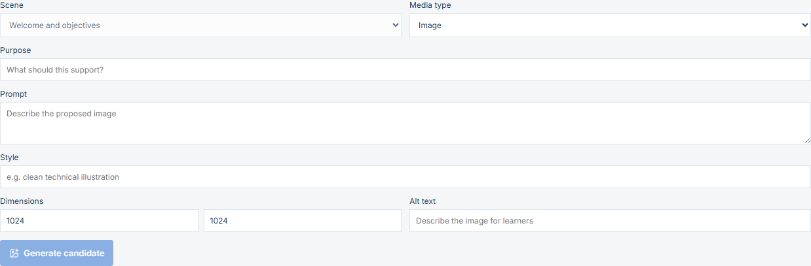</a> |
| 2 | Enter **Purpose**, **Prompt**, optional **Style**, **Dimensions**, and **Alt text**. | The request form describes the candidate. Provider support determines valid dimensions. |  |
| 3 | Click **Generate candidate** and wait for a candidate or error. | A successful request yields a pending candidate without attaching it to the storyboard. |  |

### Request narration

| Step | Action | Result | Control image |
| --- | --- | --- | --- |
| 1 | In Media library, set **Media type** to **Narration** and verify the target scene. | Narration fields replace image fields. | <a href="user-guide/images/media-narration-form.png">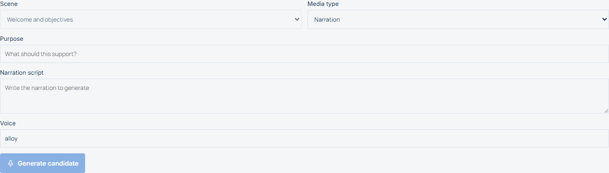</a> |
| 2 | Enter **Purpose**, **Narration script**, and a provider-supported **Voice**. | The narration request is prepared. |  |
| 3 | Click **Generate candidate**. | A successful provider run returns an audio candidate for review. |  |

### Approve, reject, or regenerate a media candidate

| Step | Action | Result | Control image |
| --- | --- | --- | --- |
| 1 | Inspect the image or listen to the audio under **Candidate review**. Confirm that the selected scene is the intended target. | You review the asset before attachment. | <a href="user-guide/images/candidate-review.png">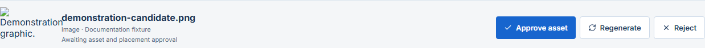</a> |
| 2 | Click **Approve asset** to approve and attach it, **Reject** to discard the candidate from consideration, or **Regenerate** to request another candidate. | Only approval places the candidate into the active project/scene; regeneration may incur provider usage. |  |
| 3 | After approval, check the asset in the media library, its attribution, accessibility details, and course preview. | The approved asset is reviewed in its actual context. |   <a href="user-guide/images/top-actions.png">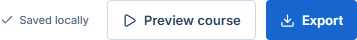</a> |

## 9. Play and comment on the storyboard

Preview progress is stored in this browser. It is separate from a learner’s LMS session. In-app discussion is available; externally shared review links and timestamp-entry controls are not part of this documented interface.

### Play the storyboard

| Step | Action | Result | Control image |
| --- | --- | --- | --- |
| 1 | Click **Preview course** in the top bar. | The playable storyboard opens. |  |
| 2 | Use **Next**, **Previous**, or a scene navigation dot. Play attached audio with its player controls. | You review scene order, content, and media; required progress updates. | <a href="user-guide/images/preview-navigation.png">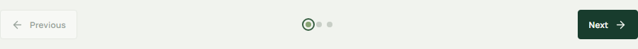</a> <a href="user-guide/images/preview-audio.png">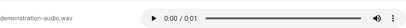</a> |
| 3 | Use **Read slide text** when shown for a rendered imported slide. Click **Exit preview** to return to authoring. | You can inspect extracted text and resume editing. | <a href="user-guide/images/slide-transcript.png">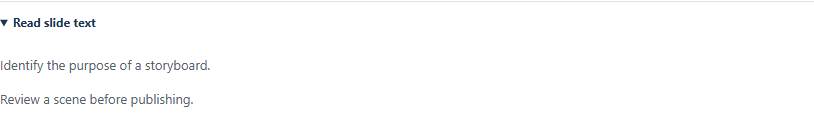</a> <a href="user-guide/images/preview-header.png">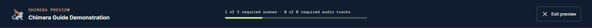</a> |

### Test an assessment in preview

| Step | Action | Result | Control image |
| --- | --- | --- | --- |
| 1 | Navigate to the assessment scene. Select an answer, enter text, order items, or match/drag items as appropriate. | A response is prepared. | <a href="user-guide/images/learner-question.png">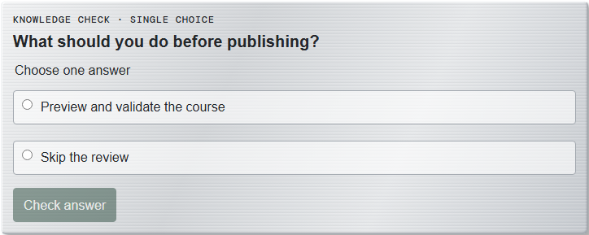</a> |
| 2 | Click **Check answer**; use **Try again** when offered after an incorrect attempt. | Feedback, score, and attempt count appear. Correct answers or exhausted attempts disable further attempts. | <a href="user-guide/images/remediation.png">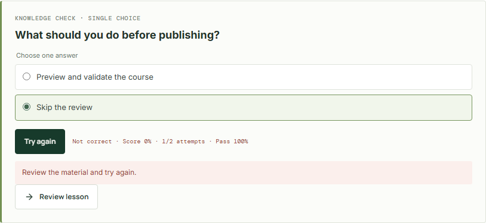</a> <a href="user-guide/images/learner-result.png">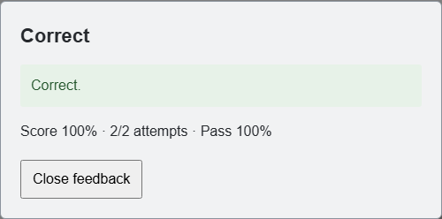</a> |
| 3 | If **Review lesson** is offered, follow it and use **Return to question** to resume. | The remediation path is exercised. | <a href="user-guide/images/return-question.png">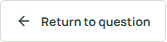</a>  |

### Add a scene comment

| Step | Action | Result | Control image |
| --- | --- | --- | --- |
| 1 | During preview, navigate to the scene and scroll to **Scene discussion**. | Feedback will be associated with that scene and review revision. | <a href="user-guide/images/scene-discussion.png">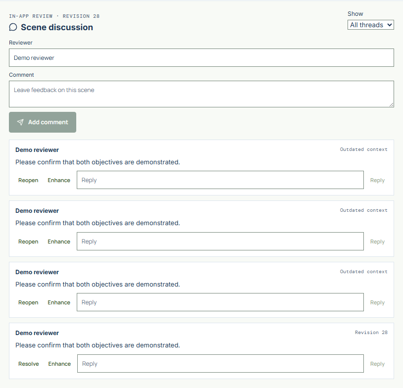</a> |
| 2 | Enter **Reviewer** and **Comment**, then click **Add comment**. | A persistent discussion thread is created. |  |

### Reply to a comment

| Step | Action | Result | Control image |
| --- | --- | --- | --- |
| 1 | Find the thread in Scene discussion and enter text in its **Reply** field. | A reply is prepared. |  |
| 2 | Click **Reply** beside the field. | The reply is added to the thread. |  |

### Resolve, reopen, and filter comments

Outdated context means the underlying review context has changed; revisit the current scene before acting on that feedback.

| Step | Action | Result | Control image |
| --- | --- | --- | --- |
| 1 | Choose **All threads**, **Unresolved**, or **Outdated** from **Show**. | The discussion list is filtered. |  |
| 2 | Click **Resolve** on an addressed thread. | The thread is marked resolved. |  |
| 3 | Choose All threads if necessary, then click **Reopen** to resume discussion. | The thread becomes unresolved again. | <a href="user-guide/images/resolved-thread.png">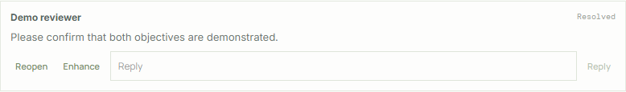</a> |

### Request enhancement from a comment

This shortcut submits no reference resources in the current implementation. Use the normal enhancement form when you need selected references or a submission preview.

| Step | Action | Result | Control image |
| --- | --- | --- | --- |
| 1 | Read the comment and click **Enhance** on its thread. | Chimera requests enhancement for that scene using the comment as the goal. This action submits directly when the provider is configured. |  |
| 2 | Exit preview and open **Review tools → Review suggestions** to inspect the job and any proposals. | Suggestions still require explicit approval. |    |

## 10. Validate course readiness

### Validate an authoring draft

| Step | Action | Result | Control image |
| --- | --- | --- | --- |
| 1 | Open **Review tools → Validate storyboard**. | The validation report opens in Authoring mode. |  <a href="user-guide/images/validation.png">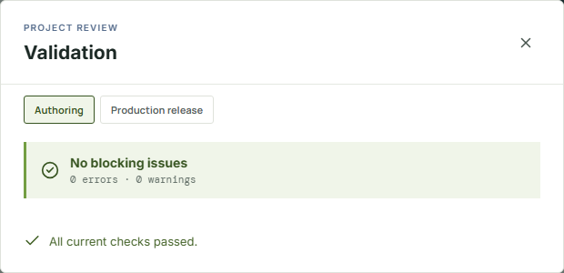</a> |
| 2 | Review errors and warnings. Use **Open scene** or **Add description** where offered. | The relevant editor opens so you can fix the issue. | <a href="user-guide/images/validation-issues.png">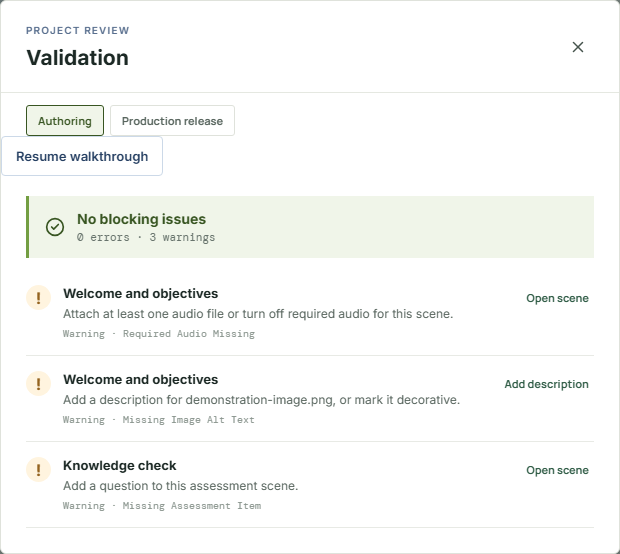</a> |
| 3 | Save corrections and reopen validation. | A new report reflects the saved storyboard. |   |

### Check production readiness

Passing validation is not certification for every LMS. Pending suggestions and unresolved discussion should be reviewed deliberately; they do not automatically represent published changes.

| Step | Action | Result | Control image |
| --- | --- | --- | --- |
| 1 | In validation, click **Production release**. | Chimera runs production checks. |  |
| 2 | Resolve blocking errors, including missing assets or incomplete attribution, and inspect warnings. Reopen the report after changes. | The report shows whether current production checks pass. |  |

## 11. Export course deliverables

Open Export for the intended saved project. Export uses saved content, not unsaved dialog edits or pending proposals. SCORM 2004 has recorded Blackboard verification for a specific artifact; consult the [compatibility checklist](scorm-compatibility-checklist.md) for the scope of testing.

### Build a SCORM package

LMS upload controls are outside Chimera and vary by platform. Verify launch, media, completion, score, and resume in the destination LMS.

| Step | Action | Result | Control image |
| --- | --- | --- | --- |
| 1 | Click **Export** in the top bar. | The Export course dialog opens. |  |
| 2 | Choose **Build SCORM 2004** or **Build SCORM 1.2** according to the receiving LMS. | After validation and build, the browser downloads a ZIP, or shows an actionable error. |  |
| 3 | Keep the ZIP intact and upload it using the receiving LMS’s SCORM-package workflow. | The LMS can launch and track the package after its own acceptance checks. |  |

### Set a package-size warning and download build reports

A report may be absent before the first build. Verify its revision/date before treating it as evidence for a newer package.

| Step | Action | Result | Control image |
| --- | --- | --- | --- |
| 1 | In Export, change **Warn when a package exceeds** and leave the field to save a valid value. | The warning threshold is saved in MB. |  |
| 2 | After building the corresponding profile, click **Report 2004** or **Report 1.2**. | The latest available profile build report downloads. |  |

### Export an editable Word storyboard

Edits made in Word do not synchronize back into Chimera. Word reimport is not exposed by this interface.

| Step | Action | Result | Control image |
| --- | --- | --- | --- |
| 1 | Open **Export** and locate **Editable Word storyboard**. | The Word controls are visible. |   |
| 2 | Choose whether to **Include answer keys (authoring material)**. | The document’s answer-key policy is selected. |  |
| 3 | Click **Download Word document**, then open the DOCX in Word. | Scene text and authoring specifications are editable; images remain images and interactions are documented rather than playable. |  |

### Export one assessment as QTI

Chimera attempt/retry settings are not equivalent to settings in the receiving assessment system; verify them after import.

| Step | Action | Result | Control image |
| --- | --- | --- | --- |
| 1 | Open the question editor, complete the question, and click **Save question**. | The current question becomes eligible for item export. |  |
| 2 | Click **Export QTI item**. | A QTI 2.1 item XML file downloads. |  |

### Export a multi-question QTI test

| Step | Action | Result | Control image |
| --- | --- | --- | --- |
| 1 | Save questions in at least two assessment scenes, then open **Export**. | The Assessment test section becomes available. |   |
| 2 | Click **Download QTI test**. | A QTI 2.1 test package containing the authored questions downloads. |  |

## 12. Back up and restore

Prefer portable backup when preserving the whole project. JSON contains storyboard data and asset references but not media binaries. Restore replaces active project content; select the target carefully and download a current backup first.

### Download a portable project backup

Build outputs/reports, media-generation job records, and the generated-candidate index are excluded by the current archive policy. Do not treat the archive as a record of every generation operation.

| Step | Action | Result | Control image |
| --- | --- | --- | --- |
| 1 | Open **Export → Storyboard backup**. | Backup controls are visible. |   |
| 2 | Click **Download portable backup** and retain the ZIP. | A project archive includes authored project files, resources, review records, history, and referenced templates according to the archive policy. |  |

### Restore a portable backup

| Step | Action | Result | Control image |
| --- | --- | --- | --- |
| 1 | Select the intended destination project and download its current portable backup. | You have a separate recovery copy. |   |
| 2 | Click **Restore portable backup** and select the archive; read and confirm the replacement prompt if intended. | Chimera validates and restores the archive or reports an error. |  |
| 3 | Inspect scene order, media, references, comments, and validation after restoration. | The restored project can be checked before further authoring or publication. |   |

### Export storyboard JSON

Use this for structured transfer of storyboard data. It is not a self-contained media backup.

| Step | Action | Result | Control image |
| --- | --- | --- | --- |
| 1 | Open **Export** and click **Download JSON**. | The storyboard and asset-reference data download as JSON. |   |

### Restore storyboard JSON

| Step | Action | Result | Control image |
| --- | --- | --- | --- |
| 1 | Verify that referenced assets and templates already exist in the target project. | Required dependencies are available for restoration. |   |
| 2 | Open **Export → Restore JSON**, choose the JSON file, and read the replacement confirmation. | You can confirm or cancel replacement of the active storyboard. |  |
| 3 | Confirm if intended, then inspect the restored storyboard. | Valid JSON replaces storyboard data and preserves the previous storyboard in history; invalid input reports an error. |   |

## 13. Review project health

### Inspect My Work

This view is a local management foundation. It does not provide a complete team-administration interface or establish that external identity integration is configured.

| Step | Action | Result | Control image |
| --- | --- | --- | --- |
| 1 | Click **My Work** in the sidebar. | My Work fills the main workspace, with sidebar navigation still available. |  |
| 2 | Review project counts, pending approvals, unresolved comments, publication blockers, identity/policy information, and recent activity. | You can identify projects that need attention. |  |
| 3 | Click **Return to authoring**, then use the project selector to open a course. | You return to the authoring workflow. |   |

## Features without a documented user-facing workflow

Do not follow the implementation build plan as if every planned control already exists. The following have no complete workflow in the interface captured here:

- Externally shared reviewer links and invitation management.
- Video upload, caption/transcript authoring, arbitrary media placement, and course-wide/shared media-library controls.
- Full reference-resource classification, authority, version-management, and per-scene mapping editors.
- Word reimport or automatic synchronization of external edits.
- A general history browser and arbitrary revision restore.
- Scene timestamp/asset-anchor entry for comments.
- Generated video and a full media-generation job/cost dashboard.

See the [implementation build plan](storyboard-export-enhancement-build-plan.md) for planned scope. Availability should be checked against the running application, not inferred from that plan.

## Troubleshooting

| Symptom | What to do |
| --- | --- |
| Projects or libraries do not load | Confirm both local services are running and inspect the displayed error. |
| A control is disabled | Select a project/scene, complete required fields, or wait for the current operation. AI Submit run also needs server configuration. |
| PowerPoint imports without a slide image | Check the render warning and LibreOffice availability. Inspect extracted text and media. |
| Media upload is rejected | Check the supported image/audio extension, file validity, and 100 MB limit. |
| A reference cannot be selected | Inspect its extraction status. Supply readable text when extraction is incomplete. |
| A proposal or save reports a revision conflict | Reload the latest project and compare changes before trying again. Preserve unsaved text separately first. |
| A SCORM build is blocked | Run Production release validation and resolve the listed errors. |
| A QTI test button is missing | Save at least two authored assessment questions. |
| JSON restore reports missing references | Make required media/templates available, or use a portable backup that includes dependencies. |
| AI generation does not yield a candidate | Check the visible error and ask the administrator to inspect provider/job configuration. The media form has no complete job monitor. |

## Screenshot and verification record

Screenshots were captured from the actual local frontend and an isolated backend workspace on 2026-09-30, using a compatible headless Chromium browser, a 1500-pixel-wide viewport, and Light appearance. Images are stored in `docs/user-guide/images/` and contain demonstration data only. Proposal, generated-candidate, and enhancement-job examples were seeded locally to expose conditional controls. No paid generation or external submission was performed.

UI navigation, proposal acceptance, commenting/resolution, and sample assessment playback were exercised while capturing screens. This documentation pass does not constitute a complete regression test, Word rendering qualification, AI-provider certification, or LMS test. Screenshots should be refreshed whenever control labels or workflows change.

Capture details and refresh instructions: [manifest](user-guide/capture-manifest.json) and [maintainer instructions](user-guide/support/README.md).
