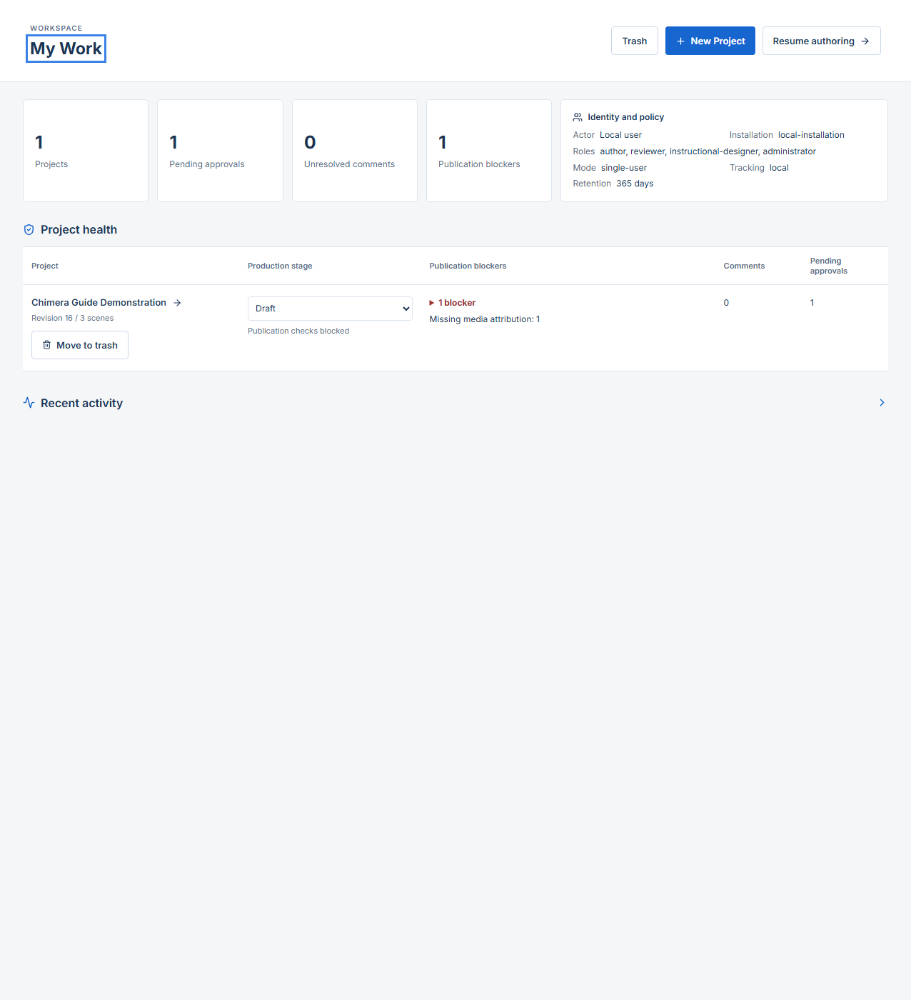
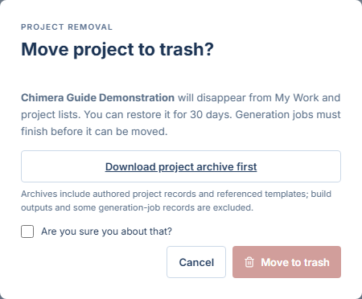
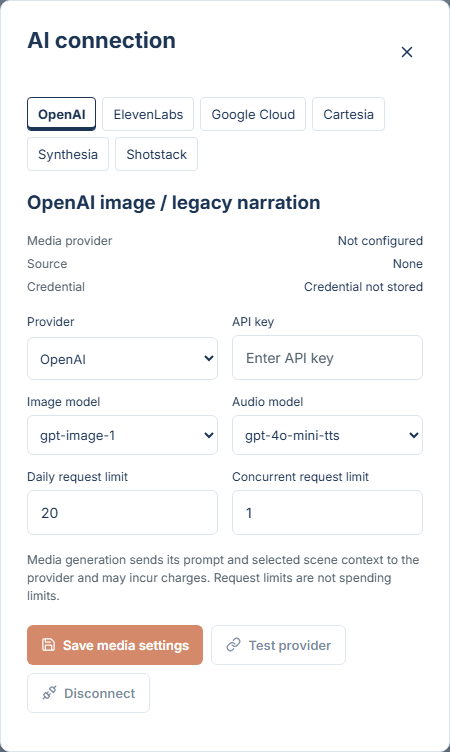
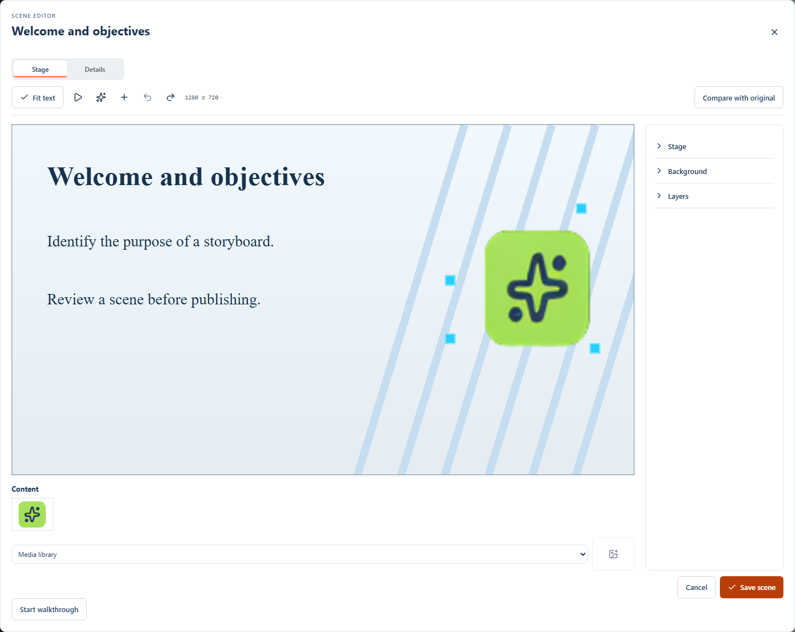
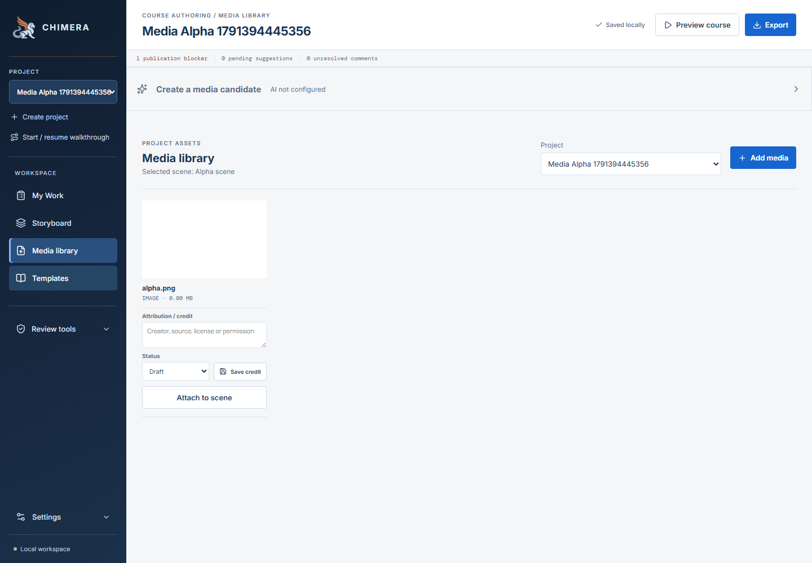

# Chimera user guide

Process-based instructions for Chimera. Workflow text updated 2026-10-15, including Pythia analysis, transformation, assessment design, and course review. Screenshots last refreshed 2026-10-08 from commit `4ade811` plus then-uncommitted working-tree updates; they predate the current Pythia controls and Settings labels. Captures use the isolated user-guide demonstration workspace and made no live AI requests or use of credentials. Historical source/recovery context is documented in the [recovery record](export-enhancement-recovery.md).

## How to use this guide

Tasks use numbered instructions or **Step / Action / Result / Control image** tables. Click a control image to open the full-size screenshot. Screenshots show the real Chimera interface in Light appearance, using an isolated demonstration project. Course names and sample content will differ in your workspace. Browser file pickers, download prompts, and confirmation dialogs vary by browser and operating system; screenshots show the Chimera controls that open them. Follow the current text labels where an older image differs.

The source has changed since the original capability review: Word export, reference upload, enhancement submission, generated-media candidate review, comments, and Chimera storyboard archives now have interface controls. Their presence does not certify a configured AI provider or compatibility with every LMS. Example proposals, candidates, and job statuses in these images are documentation fixtures; no live AI request was made for this guide.

**Prerequisite:** Start the backend and frontend using the [README setup instructions](../README.md#start-locally), then open `http://localhost:5173`. Keep both services running while authoring. LibreOffice is needed for rendered PowerPoint slide previews. Pythia workflows additionally need the Engine API; check **Settings > Intelligence Engine**. Image and narration generation use the separate **Settings > Media provider** connection or server environment settings. Shared-installation connection changes require an administrator; see [AI connection](ai-connection.md).

My Work opens after normal launch/sign-in and refresh. It is first in the workspace menu. Select a project row to open its authoring workspace, choose New Project to create one, or Resume authoring to return to the remembered project. Direct authenticated review links retain their review destination.

**Working convention:** Select the intended project and scene before editing. Use the task's Save/Create/Accept control and wait for completion. Merely typing into a form does not save it. If a revision-conflict message appears, reload the project, inspect the latest values, and reapply the intended change. Do not assume unsaved form text will survive a reload.

Optional interactive help is available under **Review tools > Guided review > All functionality walkthroughs**. Search the 68-task catalog, including nine Pythia workflows, and start the task you want to practice. The sidebar resumes your last selected walkthrough. Action steps wait for confirmed saves/downloads; Pythia draft steps wait until the draft is saved in Chimera, and review steps use Next. Escape pauses without clearing an open draft. Progress is browser-local and separate for each task/project; completing a walkthrough does not certify readiness. Restore/deletion confirmations and provider submissions remain your decisions. See the [walkthrough catalog and behavior](onboarding-implementation.md#walkthrough-catalog).

## Processes

1. [Manage projects and workspace](#1-manage-projects-and-workspace)
2. [Import and author scenes](#2-import-and-author-scenes)
3. [Manage templates](#3-manage-templates)
4. [Manage imported media and accessibility](#4-manage-imported-media-and-accessibility)
5. [Author assessments](#5-author-assessments)
6. [Import references and request enhancement](#6-import-references-and-request-enhancement)
7. [Review enhancement proposals](#7-review-enhancement-proposals)
8. [Generate and approve media](#8-generate-and-approve-media)
9. [Play and comment on the storyboard](#9-play-and-comment-on-the-storyboard)
10. [Validate course readiness](#10-validate-course-readiness)
11. [Export course deliverables](#11-export-course-deliverables)
12. [Back up and restore](#12-back-up-and-restore)
13. [Review project health](#13-review-project-health)
14. [Work with Pythia](#14-work-with-pythia)

For the PowerPoint-to-SCORM path, start with [Work with Pythia](#14-work-with-pythia). It links the existing import, media, assessment, validation, and export tasks into one human-reviewed workflow.


## 1. Manage projects and workspace

### Create a project

| Step | Action | Result | Control image |
| --- | --- | --- | --- |
| 1 | Click **New Project** on My Work, or **Create project** in the sidebar. | The course-name dialog opens. Cancelling keeps your current workspace. | <a href="user-guide/images/my-work-current.png"></a> |
| 2 | Enter a **Course name**, then click **Create project**. | A new empty project becomes active in Storyboard authoring, with production stage Draft. | <a href="user-guide/images/create-project.png"></a> |

### Switch projects

| Step | Action | Result | Control image |
| --- | --- | --- | --- |
| 1 | Open the **PROJECT** selector and choose the desired course. | The selected storyboard and project media load. | <a href="user-guide/images/project-controls.png"></a> |
| 2 | Check the course title above the workspace before continuing. | Subsequent edits apply to the intended project. | <a href="user-guide/images/workspace.png"></a> |

### Organize subprojects

Subprojects are full projects attached to a top-level project. Only two levels are supported; a subproject cannot have its own children. Attachment organizes work without combining content or granting access.

1. In **My Work**, open a top-level project's **Project actions**.
2. Choose **Create subproject** to name and create an empty child, or **Attach existing project** to attach a standalone project. A project that already has children cannot become a subproject.
3. Expand **visible subprojects** to see children you can access. Each retains its own production stage, blockers, and approval workflow. The parent summary counts only visible children and does not change the parent's stage.
4. Open a child's **Project actions > Manage subproject** to select a different **Parent project**, choose **None (detach to top level)**, or change **Display order**. Lower numbers appear first; ties use a stable project-ID order.
5. Use the grouped **PROJECT** or Media library selector to navigate. In child authoring, the parent breadcrumb opens the parent. Close or save current forms before switching projects.

Scenes, media, background defaults, review records, permissions, completion rules, and exports remain independent. A child's scenes inherit only that child's project background, not the parent's background. Viewing a parent does not grant access to its children. Managing relationships requires settings access on the child and the affected parents; creating a subproject also requires permission to create projects. Unavailable parents are labeled without exposing their titles.

Exports and project archives include only the selected project's content, not its parent or children. Archive restore preserves the current live attachment rather than applying an old relationship from the archive.

### Move a project to Trash and restore it

Project owners can move a project to Trash from its row in **My Work**. Projects remain recoverable for 30 days; opening Trash removes expired entries. Projects with queued or running generation jobs must wait until those jobs finish. In shared installations, administrators can also manage project trash.

A parent with active subprojects cannot be trashed: first move, detach, or individually trash its children. Trashing a child affects only that child. In Trash, a child's **Restore parent** defaults to its original parent, provided that parent remains available and authorized. If it is unavailable, explicitly select another permitted top-level parent or **None (restore to top level)** before restoring. No content is silently reassigned.

| Step | Action | Result | Control image |
| --- | --- | --- | --- |
| 1 | In **My Work**, choose **Move to trash** for the project. Optionally download its project archive first. | The confirmation explains the 30-day recovery period and archive exclusions. | <a href="user-guide/images/my-work.png"></a> |
| 2 | Select **Are you sure you about that?**, then confirm **Move to trash**. | The project disappears from active lists and authoring. If it was open, Chimera switches to another active project or an empty workspace. | <a href="user-guide/images/trash-confirmation.png"></a> |
| 3 | Open **Trash** in My Work and choose **Restore** before the recovery date. | The project and its files return to the active workspace. | <a href="user-guide/images/my-work.png"></a> |

### Change appearance

| Step | Action | Result | Control image |
| --- | --- | --- | --- |
| 1 | Open **Settings** at the bottom of the sidebar. | Appearance options become available. | <a href="user-guide/images/workspace.png"></a> |
| 2 | Choose **Light**, **Dark**, or **System**. | The preference is applied and remembered in this browser. | <a href="user-guide/images/appearance.png"></a> |

### Configure the media provider

This connection serves image and narration generation, not storyboard enhancement or Pythia's learning-intelligence providers. Check **Settings > Intelligence Engine** for analysis, transformation, assessment, course review, and enhancement status; see [Pythia prerequisites](#before-you-start-with-pythia). Older screenshots call the media connection **AI connection**.

| Step | Action | Result | Control image |
| --- | --- | --- | --- |
| 1 | Open **Settings > Media provider**. | Media generation connection status appears; shared-installation non-admins see a read-only view. | <a href="user-guide/images/ai-connection-current.png"></a> |
| 2 | Choose approved image/audio models, enter the API key, and set request limits. Click **Save media settings**. | The key is stored in the server's OS credential store and cleared from the form. Saving fails closed when secure storage is unavailable. | <a href="user-guide/images/ai-connection-current.png"></a> |
| 3 | Click **Test provider** after saving. | A models-list request checks the credential without sending course content or generating media. Model access and costs still depend on the provider account. | <a href="user-guide/images/ai-connection-current.png"></a> |
| 4 | To disable AI, click **Disconnect** and confirm. | The saved key is deleted and environment fallback is disabled. Running requests may finish; queued jobs against changed settings require resubmission. | <a href="user-guide/images/ai-connection-current.png"></a> |

Request limits are not spending limits. Set a provider-account budget and confirm organisational data-use approval before enabling generation. See [AI connection](ai-connection.md) for credential-store provisioning and operational requirements.

### Follow the guided workflow

For an interactive first-scene walkthrough, choose **Start / resume walkthrough** in the sidebar or in Guided review. The guide highlights the relevant control and advances after a confirmed project/scene save. Existing projects begin at scene creation. **Escape** or **Pause guide** hides the guide without discarding the open form; use **Resume walkthrough** inside that form to continue. Skipping a step ends the walkthrough without marking it complete. Restarting creates new practice content; it does not reset the project. See the [implementation and verification record](onboarding-implementation.md).

| Step | Action | Result | Control image |
| --- | --- | --- | --- |
| 1 | Expand **Review tools** and click **Guided review**. | The Golden Path checklist opens. | <a href="user-guide/images/review-tools.png"></a> |
| 2 | Read a step and use its action, such as **Review scenes**, **Open media library**, or **Run validation**. | Chimera opens that task; unavailable steps depend on project content. | <a href="user-guide/images/guided-review.png"></a> |

## 2. Import and author scenes

Scene creation and edits are saved locally. History snapshots are maintained by the application; there is no general history browser or restore-history button documented in this interface.

### Import a PowerPoint storyboard

Importing another deck updates the project from that deck. Download a Chimera storyboard first if the current authored work must be retained independently. Captured animation XML does not guarantee equivalent playback.

| Step | Action | Result | Control image |
| --- | --- | --- | --- |
| 1 | Select the project, then click **Import PowerPoint** above the scene list. | The file picker opens. | <a href="user-guide/images/project-controls.png"></a><br><a href="user-guide/images/scene-sequence.png"></a> |
| 2 | Choose a `.pptx` file and wait for processing. | Scenes, extracted content, and supported media appear; slide rendering may report a LibreOffice warning. | <a href="user-guide/images/scene-sequence.png"></a> |
| 3 | Select each imported scene and inspect its text, notes, media, and preview. | You can identify extraction or rendering issues before publishing. | <a href="user-guide/images/workspace.png"></a> |

### Create a scene

| Step | Action | Result | Control image |
| --- | --- | --- | --- |
| 1 | Click the **+** control labeled **Add scene**. | The New scene dialog opens. | <a href="user-guide/images/scene-sequence.png"></a> |
| 2 | Enter **Scene title**, select **Scene type** and **Scene layout**, and enter **On-screen text**. Set directions, notes, and **Required scene** as needed. | The new scene is prepared in the form. | <a href="user-guide/images/new-scene.png"></a> |
| 3 | Click **Create scene**. | The scene is appended and saved. | <a href="user-guide/images/new-scene.png"></a> |

### Edit scene content and settings

The **Edit scene** dialog combines scene details and canvas authoring. On-screen text is learner content; action descriptions and speaker notes are authoring material. Inspect playback and exports rather than assuming changes to extracted text redraw an imported slide image.

| Step | Action | Result | Control image |
| --- | --- | --- | --- |
| 1 | Select a scene, then click **Edit scene** or its pencil icon. | The unified scene editor opens on Details. | <a href="user-guide/images/workspace.png"></a><br><a href="user-guide/images/scene-sequence.png"></a> |
| 2 | In **Details**, update the title, type, layout, on-screen text, action description, speaker notes, or required status. Choose **Canvas** to edit the visual layout in the same dialog. | Both sections share one draft and one save action. | <a href="user-guide/images/scene-editor.png"></a> |
| 3 | Click **Save scene**; use **Cancel** to discard edits from either section. | Saved changes update the storyboard and its revision. | <a href="user-guide/images/scene-editor.png"></a> |

### Edit text and images on the canvas

Open **Edit scene**, then choose **Canvas**. The canvas editor saves an editable layout; it does not paint over the flattened PowerPoint preview. Canvas edits to an imported slide use Hybrid rendering so the edited layers, rather than an unchanged flattened image, are shown.



1. For an older imported scene, choose **Extract source layout** to recover positions and inherited artwork from the retained PPTX. This preserves scene IDs, notes, questions, review threads, existing assets, and authored text. The extracted layout remains inactive until **Save scene**. Cancelling keeps the extracted data but does not change playback.
2. Double-click a text box, or focus it and press Enter, to edit its text directly. The **Text** field also edits the selected box. Drag boxes to move them, use resize handles, or enter exact position and size in the properties panel. Text resize handles preserve the box's current aspect ratio; image resize handles allow freeform sizing. Arrow keys move the focused element; Shift changes the step from one to ten slide-space units.
3. Drag an **Attached images** thumbnail onto the canvas. Clicking the thumbnail adds it without dragging. The media-library selector can add other project images. Selecting an image exposes replacement and crop-reset controls.
4. Use **Layers** to select overlapping or inherited content. Master and layout artwork starts locked; unlock it before editing. Toolbar controls add text, undo/redo, duplicate/delete elements, and change stacking order. Text properties include size, color, typeface, alignment, bold, and italic.
5. Expand **Background** in the properties panel to choose a color and open the **Background image** thumbnail picker. Choose **Use project background**, a scene image, or **None** to explicitly opt out of the project image. Imported PowerPoint master backgrounds are labeled in the picker. Set the default under **Settings > Project background**; changing it affects only inheriting scenes, not scene-specific images or explicit None choices. Add images in Media library first. Backgrounds fill the stage and are decorative; check contrast and keep instructional information in accessible text. **Source slide**, when available, temporarily shows the original flattened rendering for comparison and is not changed by background settings.
6. Choose **Save scene**, then check **Preview course**. The saved canvas replaces the source preview in authoring, preview, and both SCORM profiles. **Cancel** discards unsaved canvas changes.

New imports capture editable text, images, common PowerPoint shapes, line connectors, custom freeform geometry, rotation, cropping, slide dimensions, inherited graphics, and solid/picture backgrounds. Byte-identical images are shared as one Media library asset while every source placement stays separate on the canvas. Most extracted shapes can be moved, resized, rotated, layered, locked, or deleted like other canvas elements; text inside a shape remains separately editable. The original preview remains available for comparison. Less-common preset geometry, gradients, group rotation, mixed text formatting, bullets, and some inherited styles may be approximated and are listed under **Import limitations**; charts and SmartArt remain unsupported objects. This is not full PowerPoint-equivalent editing.

For a scene with an enabled visual layout, edits to **On-screen text** in the original metadata dialog also update the corresponding visual text boxes. The scene title remains the navigation label; use the canvas editor to change a title drawn on the slide.

### Jump directly to another scene

In **Preview course**, open **Contents** and choose a scene by number and title. The list marks the current and visited scenes. Jumping preserves assessment answers and audio-completion state, and only the selected scene becomes visited. Exported SCORM players provide a **Contents** selector with the same scene sequence.

The reviewer form follows Light and Dark appearance for labels, fields, thread text, and controls. Its contrast is qualified in both modes.

### Reorder scenes

| Step | Action | Result | Control image |
| --- | --- | --- | --- |
| 1 | Locate the scene in the scene list. Drag its row to the target position, or use its up/down arrow buttons. | The sequence is changed and saved. | <a href="user-guide/images/scene-sequence.png"></a> |
| 2 | Select the moved scene and verify its position. | The course sequence reflects the intended order. | <a href="user-guide/images/scene-sequence.png"></a> |

### Delete a scene

Download a Chimera storyboard before deletion when you need an accessible recovery copy. History storage does not imply a visible one-click undo control.

| Step | Action | Result | Control image |
| --- | --- | --- | --- |
| 1 | Select the trash icon beside the scene to remove. | A confirmation describes the deletion and relevant consequences. | <a href="user-guide/images/scene-sequence.png"></a> |
| 2 | Read the confirmation and confirm only if the correct scene is named; otherwise cancel. | The scene is removed after confirmation; the previous storyboard is retained in history. | <a href="user-guide/images/scene-sequence.png"></a> |

## 3. Manage templates

### Upload a scene template

| Step | Action | Result | Control image |
| --- | --- | --- | --- |
| 1 | Choose **Templates** in the sidebar. | The template library opens. | <a href="user-guide/images/workspace.png"></a> |
| 2 | Click **Upload PPTX template** and select a `.pptx` file, up to 50 MB. | The uploaded template appears in the library. | <a href="user-guide/images/templates.png"></a> |

### Edit template details

| Step | Action | Result | Control image |
| --- | --- | --- | --- |
| 1 | In **Templates**, click **Edit details** for the intended template. | The template editor opens. | <a href="user-guide/images/templates.png"></a> |
| 2 | Change **Template name** and **Description**, then click **Save template**. | The library metadata is updated. | <a href="user-guide/images/template-details.png"></a> |

### Replace a template source deck

| Step | Action | Result | Control image |
| --- | --- | --- | --- |
| 1 | In **Templates**, locate the correct template and click **Replace PPTX**. | The file picker opens for that template. | <a href="user-guide/images/templates.png"></a> |
| 2 | Choose the revised `.pptx` file and wait for completion. | The template source is replaced; inspect affected scenes before publishing. | <a href="user-guide/images/templates.png"></a> |

### Assign a template to a scene

Scene layout chooses how the scene is rendered:

- **Fidelity** keeps the rendered source slide.
- **Hybrid** uses the extracted slide background and editable slide layers.
- **Native** uses a clean white canvas with the scene's learner-facing text.
- **Template** uses the selected PPTX's first-slide design and master/layout artwork, replacing its sample text with the scene content.

PowerPoint effects that Chimera cannot represent may be approximated or omitted; compare the result with the source slide before publishing.

| Step | Action | Result | Control image |
| --- | --- | --- | --- |
| 1 | Open the scene editor and set **Scene layout** to **Template**. | A Template selector appears. | <a href="user-guide/images/scene-editor.png"></a> |
| 2 | Choose a template, then click **Save scene** or **Create scene**. | The scene background and editable design layers update to the selected template. | <a href="user-guide/images/template-selection.png"></a> |

## 4. Manage imported media and accessibility

The current upload interface accepts images and audio, up to 100 MB per file. Images: JPG, PNG, GIF, WebP. Audio: MP3, M4A, AAC, WAV, OGG. Video import, a shared media library across projects, and explicit course-wide placement are not exposed by these controls.

### Add external media



| Step | Action | Result | Control image |
| --- | --- | --- | --- |
| 1 | Select the intended scene in **Storyboard**, then open **Media library**. | The media view identifies the selected scene. | <a href="user-guide/images/scene-sequence.png"></a><br><a href="user-guide/images/workspace.png"></a> |
| 2 | Select the intended project using **Project** (defaults to the current project), then click **Add media** and choose a supported file. | The asset is added to the selected project library. Adding media does not by itself attach it. | <a href="user-guide/images/media-library.png"></a> |

### Create a media candidate

Configure image and narration generation through **Settings > Media provider** before generating candidates. In shared deployments, an installation administrator manages the connection. See [AI connection](ai-connection.md) for credential storage, connection testing, limits, and data handling. This connection is separate from Pythia.

Create a media candidate starts collapsed. Select its heading to expand it. When the server-side AI connection is not configured, its heading is greyed and generation controls are disabled. If connection status cannot be loaded or your role does not permit generation, controls also remain disabled. Configuration availability does not guarantee that a provider is reachable or supports a particular model. Existing candidates can still be approved or rejected without a configured AI connection; regeneration requires the connection.

The Media Library project selector defaults to the current project. Selecting another project opens that project's media library and makes it the current project; media files are not copied between projects.

### Attach or detach scene media

The screenshot shows an attached example and its Detach media button. The same control reads Attach to scene when the asset is not attached.

| Step | Action | Result | Control image |
| --- | --- | --- | --- |
| 1 | Select the target scene in **Storyboard**, return to **Media library**, and locate the asset. | The selected scene determines the attachment target. | <a href="user-guide/images/scene-sequence.png"></a><br><a href="user-guide/images/media-library.png"></a> |
| 2 | Click **Attach to scene**. For an attached asset, click **Detach media** to remove the scene association. | The scene reference changes; detaching does not delete the library asset. | <a href="user-guide/images/attach-media.png"></a><br><a href="user-guide/images/media-library.png"></a> |

### Record media attribution

| Step | Action | Result | Control image |
| --- | --- | --- | --- |
| 1 | In a media card, fill **Attribution / credit** with creator, source, and license or permission information. | Attribution text is prepared. | <a href="user-guide/images/media-library.png"></a> |
| 2 | Choose **Draft** while unfinished or **Complete** when verified, then click **Save credit**. | The attribution status is saved. Production validation reports pending image attribution as a warning so export can proceed; verify the credit before release. | <a href="user-guide/images/media-library.png"></a> |

### Describe scene images

You can enter **Alternative text** or select **Decorative image** directly in an image's Media library card beside its attribution. The description heading identifies the selected scene. For an attached image, **Save credit** also saves the scene description. For an unattached image, **Attach to scene** saves the attachment, description and credit; saving credit alone does not attach the image or persist its pending description. Descriptions are scene-specific, so editing one scene does not overwrite another scene's description of the same image.

| Step | Action | Result | Control image |
| --- | --- | --- | --- |
| 1 | Open **Review tools → Check image descriptions**. | Attached images are grouped by scene. | <a href="user-guide/images/review-tools.png"></a> |
| 2 | Enter **Alternative text** describing the image information, or select **Decorative image** when appropriate. | Each image has a description or explicit decorative designation. | <a href="user-guide/images/image-descriptions.png"></a> |
| 3 | Click **Save** for a scene or **Save all** for all edited scenes. Closing the panel also saves pending changes. | Saved and unsaved states are visible. A failed save leaves the panel open with your draft intact. | <a href="user-guide/images/image-descriptions.png"></a> |

Image groups identify the current storyboard scene number and title, plus the source slide when available. Media library items list every scene that uses the image or audio.

A green **Ready for production** check means the media loaded, its attribution is saved as Complete with credit text, and any image description or decorative designation is saved. In the Media library, images must meet the description requirement in every referencing scene; unattached media is not marked ready. Amber indicators identify pending saves, missing descriptions or attribution, and unavailable media. Image attribution marked **Attribution Pending** is a warning that does not block export, but the credit must be verified before release. Incomplete audio attribution remains a blocking production error. This is media readiness, not visual approval or whole-course release approval; run Production validation before release.

### Require audio completion

| Step | Action | Result | Control image |
| --- | --- | --- | --- |
| 1 | Attach audio to the scene, then return to its storyboard view. | The required-audio checkbox is available below the scene. | <a href="user-guide/images/media-library.png"></a><br><a href="user-guide/images/audio-requirement.png"></a> |
| 2 | Select **Require attached audio to finish**. | Learners must finish every attached track for that audio requirement. | <a href="user-guide/images/audio-requirement.png"></a> |

## 5. Author assessments

For an assessment-first workflow, open **Review tools > Assessments**. The **Question bank** lets you add a question directly or open an existing question and its metadata without creating a slide first. Create a named assessment, select its questions, arrange them, and download its QTI test package.

Start each assessment task with a scene whose **Scene type** is **Assessment**. Set that type in Edit scene and save. Select **Create question** for a new question or **Edit question** for an existing one. The question editor supports seven types. Changing types replaces the type-specific question structure in the form; save only after checking the new content.

### Import questions with review

1. Open **Review tools > Assessments > Import questions**.
2. Select a QTI 2.1 item XML, QTI ZIP package, or filled CSV/XLSX template. Download either template in the import panel; each contains examples of all seven types.
3. Choose **Review import**. Nothing is saved at this stage. Inspect the question, answer key, feedback, metadata, errors, and warnings for each row.
4. Select the valid questions to add. Existing stable identifiers and repeated identifiers in the upload are blocked, not renamed or overwritten. Correct duplicates in the source file and review it again.
5. Optionally select a saved assessment to receive the new questions. Otherwise they enter the question bank only.
6. Acknowledge any warnings, then choose **Import selected questions**. The selected questions and group membership are saved together. If another author changed the project, review the file again before importing.

Uploads are limited to 10 MB and 500 questions. QTI import supports the representable text-only subset of the seven question types, not arbitrary LMS question formats, media, rich HTML, or custom response processing. Unsupported content is reported rather than silently discarded. Test-level navigation, selection, timing, and scoring policies are not imported as a test; choose and review Chimera's assessment rules separately.

CSV/XLSX templates use one question per row and these columns:

| Columns | Content |
| --- | --- |
| `identifier`, `type`, `title`, `prompt` | Stable question ID, one of the seven type names, authoring title, and learner prompt. |
| `choices`, `secondaryChoices` | JSON arrays of `{"identifier":"A","text":"Answer"}` objects. For matching and drag-and-drop, use primary items in `choices` and targets/right items in `secondaryChoices`. |
| `answers` | JSON array of correct choice IDs, ordered IDs, accepted answer strings, `"true"`/`"false"`, or `{"sourceIdentifier":"A","targetIdentifier":"B"}` pairs, depending on type. |
| `correctFeedback`, `incorrectFeedback`, `caseSensitive` | Feedback and fill-in-the-blank case-matching behavior. |
| `description`, `tags`, `author`, `source`, `language`, `difficulty`, `learningObjectiveRefs` | Question metadata. Tags and objective references are JSON string arrays. Difficulty is blank, `easy`, `medium`, or `hard`. Language uses a tag such as `en-US`. |

Use the supplied examples rather than changing the headers. XLSX formulas are not evaluated or imported as question content. Spreadsheet imports do not carry assessment membership or course-specific rules. **Export questions CSV/XLSX** downloads authored questions and metadata in the same format.

### Edit question metadata

Open a question and expand **Tags and learning-objective references** at the bottom of the editor. This section starts collapsed; both fields use compact search/dropdowns. Focus the search field or choose **Select** to open its scrollable dropdown. Suggestions come from saved questions in the current project; search is case-insensitive and excludes values already selected. Select a suggestion to reuse its spelling, or choose **Create** (or press Enter) for a new value. Arrow keys navigate dropdown options; Enter selects and Escape closes the dropdown. Use **Remove** to remove a selected value, then **Save question** to persist your selections. Each field allows up to 50 values, each up to 200 characters. Expand **Question metadata** for its title, stable identifier, description, author, source, language, and difficulty. Tags and other metadata are authoring information and are not shown as learner-facing question content. References are identifiers or labels; adding them does not create or modify learning objectives.

The stable identifier starts with a letter and contains up to 64 letters, digits, underscores, or hyphens. Keep it unchanged when maintaining a question's identity outside Chimera. Title defaults to the scene title when not specified. Tags and objective references accept up to 50 unique entries, at most 200 characters each.

Metadata is retained in project data and spreadsheet exports. QTI uses the standard item title and XML language attributes; remaining Chimera metadata and supported item settings travel in a `chimera` XML processing instruction for round trips. Other QTI systems may ignore this extension. Course-specific remediation links cannot be carried into another project and are reported during import. QTI import/export still requires qualification against the target LMS; export availability is not a certification of LMS compatibility.

### Open or create an assessment question

| Step | Action | Result | Control image |
| --- | --- | --- | --- |
| 1 | Edit the scene, choose **Assessment** under **Scene type**, and save. | The scene displays the question-authoring section. | <a href="user-guide/images/scene-editor.png"></a> |
| 2 | Click **Create question** or **Edit question** below the canvas. | The question editor opens. | <a href="user-guide/images/assessment-create.png"></a><br><a href="user-guide/images/assessment-launch.png"></a> |

### Author a single-choice question

| Step | Action | Result | Control image |
| --- | --- | --- | --- |
| 1 | Choose **Multiple choice ? one answer**, enter the **Question prompt** and answer text, and mark exactly one answer as correct. Use **Add answer choice** or the minus buttons as needed. | The question content and correct response are defined. | <a href="user-guide/images/question-single-choice.png"></a> |
| 2 | Enter **Correct feedback** and **Incorrect feedback**, then click **Save question**. | The question is saved to the scene. | <a href="user-guide/images/question-single-choice.png"></a><br><a href="user-guide/images/assessment-actions.png"></a> |

### Author a multiple-correct question

| Step | Action | Result | Control image |
| --- | --- | --- | --- |
| 1 | Choose **Multiple choice ? multiple answers**, enter the prompt and answer choices, and select the checkbox for every correct answer. | The question content and correct response are defined. | <a href="user-guide/images/question-multiple-response.png"></a> |
| 2 | Enter **Correct feedback** and **Incorrect feedback**, then click **Save question**. | The question is saved to the scene. | <a href="user-guide/images/question-multiple-response.png"></a><br><a href="user-guide/images/assessment-actions.png"></a> |

### Author a true/false question

| Step | Action | Result | Control image |
| --- | --- | --- | --- |
| 1 | Choose **True / False**, enter the statement as the prompt, and select **True** or **False** under Correct answer. | The question content and correct response are defined. | <a href="user-guide/images/question-true-false.png"></a> |
| 2 | Enter **Correct feedback** and **Incorrect feedback**, then click **Save question**. | The question is saved to the scene. | <a href="user-guide/images/question-true-false.png"></a><br><a href="user-guide/images/assessment-actions.png"></a> |

### Author an ordering question

| Step | Action | Result | Control image |
| --- | --- | --- | --- |
| 1 | Choose **Ordering**, enter the prompt and steps, and use the earlier/later arrows to establish the **Correct sequence**. Use **Add step** as needed. | The question content and correct response are defined. | <a href="user-guide/images/question-ordering.png"></a> |
| 2 | Enter **Correct feedback** and **Incorrect feedback**, then click **Save question**. | The question is saved to the scene. | <a href="user-guide/images/question-ordering.png"></a><br><a href="user-guide/images/assessment-actions.png"></a> |

### Author a drag-and-drop question

Type each draggable item and drop target into its text field. Use **Add draggable item** or **Add drop target** to extend either list, then assign the correct placements below the lists. Answer items currently support text only; images on the scene Stage are not draggable answer choices.

In **Preview course** and exported SCORM courses, the targets form a vertical list below the answer tiles. Drag a tile to its matching label, or select a tile and then select its target using a mouse, touch, or keyboard. Correct tiles settle beside the label and leave the answer bank; incorrect tiles return home. Drops do not use attempts; only **Check answer** does. The question Stage expands to contain the targets and **Check answer**; scroll the preview for longer questions.

| Step | Action | Result | Control image |
| --- | --- | --- | --- |
| 1 | Choose **Drag and drop**, enter the prompt, draggable items, and drop targets, then choose each correct placement. Use distinct targets for the intended matches. | The question content and correct response are defined. | <a href="user-guide/images/question-drag-drop.png"></a> |
| 2 | Enter **Correct feedback** and **Incorrect feedback**, then click **Save question**. | The question is saved to the scene. | <a href="user-guide/images/question-drag-drop.png"></a><br><a href="user-guide/images/assessment-actions.png"></a> |

### Author a matching question

Type the items into the **Left column** and **Right column** text fields. Use **Add left item** or **Add right item** as needed, then assign the **Correct matches** below the lists. Matching answer items currently support text only, not image choices.

| Step | Action | Result | Control image |
| --- | --- | --- | --- |
| 1 | Choose **Matching**, enter the prompt and left/right items, then select each correct match. | The question content and correct response are defined. | <a href="user-guide/images/question-matching.png"></a> |
| 2 | Enter **Correct feedback** and **Incorrect feedback**, then click **Save question**. | The question is saved to the scene. | <a href="user-guide/images/question-matching.png"></a><br><a href="user-guide/images/assessment-actions.png"></a> |

### Author a fill-in-the-blank question

**Fill-in-the-blank** replaces the former Short answer name. Learners enter one word or short phrase in a single blank after the prompt; this is automatically graded, not an essay or manually marked written response. Enter alternate accepted spellings or equivalent answers on separate lines. Matching ignores surrounding whitespace and, unless **Match letter case** is selected, capitalization.

Existing questions and imported/exported CSV/XLSX templates retain the `short-answer` type identifier for compatibility; no conversion of saved answers is needed. QTI 2.1 exports use an inline `textEntryInteraction` inside a paragraph and a single primary correct-response value, with exact string comparisons retaining all accepted alternatives. This corrects the former block-level placement of the blank. Blackboard import compatibility still needs verification in the target Blackboard version; a QTI 2.1 package is not a Blackboard-native question pool.

| Step | Action | Result | Control image |
| --- | --- | --- | --- |
| 1 | Choose **Fill-in-the-blank**, enter the prompt, and enter one accepted answer per line. Select **Match letter case** only when capitalization must match. | One blank and its accepted answers are defined. | <a href="user-guide/images/question-short-answer.png"></a> |
| 2 | Enter **Correct feedback** and **Incorrect feedback**, then click **Save question**. | The question is saved to the scene. | <a href="user-guide/images/question-short-answer.png"></a><br><a href="user-guide/images/assessment-actions.png"></a> |

### Configure question scoring and remediation

Current question scoring is binary: 0% or 100%. Course score weights affect the aggregate course score; they do not create partial credit within a question.

| Step | Action | Result | Control image |
| --- | --- | --- | --- |
| 1 | Open the question editor and scroll to **Assessment rules**. | Question-level settings are visible. | <a href="user-guide/images/assessment-rules.png"></a> |
| 2 | Set **Maximum attempts**, **Passing score**, **Course score weight**, and an optional **Remediation scene**. | Attempts, scoring contribution, and review destination are specified. | <a href="user-guide/images/assessment-rules.png"></a> |
| 3 | Click **Save question**. | The question and its rules are saved. | <a href="user-guide/images/assessment-actions.png"></a> |

### Remove an assessment question

| Step | Action | Result | Control image |
| --- | --- | --- | --- |
| 1 | Open the existing question and click **Remove question**. | A removal confirmation appears. | <a href="user-guide/images/assessment-actions.png"></a> |
| 2 | Confirm removal if intended. | The question is removed from the scene; the scene remains. | <a href="user-guide/images/assessment-actions.png"></a> |

### Set course completion rules

| Step | Action | Result | Control image |
| --- | --- | --- | --- |
| 1 | Open **Review tools → Completion rules**. | Course-level scoring controls open. | <a href="user-guide/images/review-tools.png"></a> |
| 2 | Select **Course passing score** and whether to **Include optional questions in course score**. | The aggregate scoring policy is prepared. | <a href="user-guide/images/completion-rules.png"></a> |
| 3 | Click **Save rules**. | The policy is saved. Required scene visits and required audio also contribute to completion. | <a href="user-guide/images/completion-rules.png"></a> |

## 6. Import references and request enhancement

This section describes **New enhancement run**, which uses Pythia's `storyboard.enhance` capability. It is separate from the analysis, transformation, assessment, and course-review dialogs described in [Work with Pythia](#14-work-with-pythia). Only the references selected in this form accompany this enhancement request; they are not automatically included in the other Pythia workflows.

Enhancement submission requires an available Intelligence Engine supporting `storyboard.enhance`, managed by an administrator in shared installations. Check **Settings > Intelligence Engine**, not **Media provider**. Without it, Preview submission remains useful, but Submit run is disabled. This documentation update made no live AI requests and does not certify provider output.

### Import a Study Guide or supporting reference

Failed or incomplete extraction disables selection. The current form does not provide full resource classification, version-management, or scene-mapping editors.

| Step | Action | Result | Control image |
| --- | --- | --- | --- |
| 1 | Open **Review tools → Review suggestions**. | Storyboard suggestions opens with the New enhancement run form. | <a href="user-guide/images/review-tools.png"></a> |
| 2 | Click **Add reference** and select PDF, DOCX, PPTX, TXT, or MD, up to 25 MB. | Chimera imports the resource and attempts text extraction. | <a href="user-guide/images/enhancement-form.png"></a> |
| 3 | Check the extraction status under **Permitted references**. Select the resource only if extraction is complete. | Selected references become eligible for the enhancement request. | <a href="user-guide/images/enhancement-form.png"></a> |

### Select enhancement scope and inspect the submission

| Step | Action | Result | Control image |
| --- | --- | --- | --- |
| 1 | Choose **Whole course** or **Selected scenes** under **Scope**; for selected scenes, check the required scene boxes. | The enhancement target is defined. | <a href="user-guide/images/enhancement-form.png"></a> |
| 2 | Enter an **Enhancement goal** and check the **Permitted references** to include. | The run is limited to the chosen content and references. | <a href="user-guide/images/enhancement-form.png"></a> |
| 3 | Click **Preview submission**, then expand **Inspect submitted content**. | You can inspect the payload, source revision, counts, estimated input units, and any available cost estimate. | <a href="user-guide/images/submission-actions.png"></a><br><a href="user-guide/images/submission-preview.png"></a> |

### Submit an enhancement run

| Step | Action | Result | Control image |
| --- | --- | --- | --- |
| 1 | Complete and inspect the submission preview. Resolve any Intelligence Engine unavailable or unsupported-capability message. | You know what will be sent and whether submission is available. | <a href="user-guide/images/submission-preview.png"></a> |
| 2 | Click **Submit run** when enabled. | An enhancement job is created; it produces proposals rather than directly applying changes. | <a href="user-guide/images/submission-actions.png"></a> |
| 3 | Review the job status and any reported resource conflicts, then review returned suggestions individually. | You can distinguish completion, failure, and suggestions needing a decision. | <a href="user-guide/images/enhancement-jobs.png"></a><br><a href="user-guide/images/proposal.png"></a> |

### Cancel or retry an enhancement job

| Step | Action | Result | Control image |
| --- | --- | --- | --- |
| 1 | In Storyboard suggestions, find the run under **Enhancement jobs**. | Its status and message are visible. | <a href="user-guide/images/enhancement-jobs.png"></a> |
| 2 | Click **Cancel** for a queued/running job, or **Retry** for a failed/cancelled job after addressing the cause. | Cancellation is requested or a retry job is started. Neither action approves proposals. | <a href="user-guide/images/enhancement-jobs.png"></a> |

## 7. Review enhancement proposals

**Review suggestions** contains several proposal types. The **Accept change**, **Edit values**, and **Undo acceptance** instructions below apply to regular enhancement proposals, including native assessment items drafted by Pythia. Pythia analysis uses **Accept review** without changing content; storyboard transformation uses **Edit proposal** and **Accept transformation**, with no undo button. Follow the [Pythia-specific decision steps](#14-work-with-pythia) for those records.

### Accept or reject a suggestion

A proposal can contain multiple related changes. Accept change applies that displayed proposal as a group, so review every included change. A source-backed label is not a substitute for checking the source.

| Step | Action | Result | Control image |
| --- | --- | --- | --- |
| 1 | Open **Review tools → Review suggestions** and locate a pending proposal. | The proposal shows its rationale, source revision, and changes. | <a href="user-guide/images/review-tools.png"></a><br><a href="user-guide/images/proposal.png"></a> |
| 2 | Compare **Current** and **Suggested** for every included change; inspect citations if provided. | You understand the complete proposal before deciding. | <a href="user-guide/images/proposal.png"></a> |
| 3 | Click **Accept change** to apply the proposal, or **Reject** to leave the storyboard unchanged. | The decision is recorded. A stale/conflicting proposal cannot overwrite newer edits. | <a href="user-guide/images/proposal.png"></a> |

### Edit a suggestion before accepting

| Step | Action | Result | Control image |
| --- | --- | --- | --- |
| 1 | On a pending proposal, click **Edit values**. | Editable suggested-value fields appear. | <a href="user-guide/images/proposal.png"></a> |
| 2 | Revise the suggested values. Structured values are labeled JSON and must remain valid JSON; use **Cancel edit** to discard these form edits. | The displayed proposed content reflects your intended version. | <a href="user-guide/images/proposal-edit.png"></a> |
| 3 | Click **Accept change**. | The edited proposal is applied if valid and current. | <a href="user-guide/images/proposal-edit.png"></a> |

### Undo an accepted suggestion

| Step | Action | Result | Control image |
| --- | --- | --- | --- |
| 1 | Locate the accepted proposal and click **Undo acceptance**. | Chimera attempts to restore the captured previous values. | <a href="user-guide/images/proposal-accepted.png"></a> |
| 2 | Inspect the resulting scene or any conflict message. | Reversal succeeds only when later changes do not prevent a safe restore. | <a href="user-guide/images/proposal-accepted.png"></a><br><a href="user-guide/images/workspace.png"></a> |

## 8. Generate and approve media

Select the target project and scene before opening Media library. Create a media candidate starts collapsed; expand its heading to access the form. Without AI configuration or generation permission, the section is greyed and generation/regeneration is disabled. Existing candidates remain reviewable. Approval attaches a candidate to its target scene; choose **Edit scene > Canvas** afterward to place supported image assets. A generation-cost preview and full media-job monitor are not provided.

### Request an image candidate

The current provider implementation sends the prompt and dimensions to image generation; put essential style directions in Prompt as well. Candidate appearance does not guarantee source or factual accuracy.

| Step | Action | Result | Control image |
| --- | --- | --- | --- |
| 1 | Open **Media library**, expand **Create a media candidate**, and verify Scene. Set **Media type** to **Image**. | The selected scene is the generation target. | <a href="user-guide/images/workspace.png"></a><br><a href="user-guide/images/media-image-form.png"></a> |
| 2 | Enter **Purpose**, **Prompt**, optional **Style**, **Dimensions**, and **Alt text**. | The request form describes the candidate. Provider support determines valid dimensions. | <a href="user-guide/images/media-image-form.png"></a> |
| 3 | Click **Generate candidate** and wait for a candidate or error. | A successful request yields a pending candidate without attaching it to the storyboard. | <a href="user-guide/images/media-image-form.png"></a> |

### Request narration

| Step | Action | Result | Control image |
| --- | --- | --- | --- |
| 1 | In Media library, set **Media type** to **Narration** and verify the target scene. | Narration fields replace image fields. | <a href="user-guide/images/media-narration-form.png"></a> |
| 2 | Enter **Purpose**, **Narration script**, and a provider-supported **Voice**. | The narration request is prepared. | <a href="user-guide/images/media-narration-form.png"></a> |
| 3 | Click **Generate candidate**. | A successful provider run returns an audio candidate for review. | <a href="user-guide/images/media-narration-form.png"></a> |

### Approve, reject, or regenerate a media candidate

| Step | Action | Result | Control image |
| --- | --- | --- | --- |
| 1 | Inspect the image or listen to the audio under **Candidate review**. Confirm that the selected scene is the intended target. | You review the asset before attachment. | <a href="user-guide/images/candidate-review.png"></a> |
| 2 | Click **Approve asset** to approve and attach it, **Reject** to discard the candidate from consideration, or **Regenerate** to request another candidate. | Only approval places the candidate into the active project/scene; regeneration may incur provider usage. | <a href="user-guide/images/candidate-review.png"></a> |
| 3 | After approval, check the asset in the media library, its attribution, accessibility details, and course preview. | The approved asset is reviewed in its actual context. | <a href="user-guide/images/media-library.png"></a><br><a href="user-guide/images/image-descriptions.png"></a><br><a href="user-guide/images/top-actions.png"></a> |

## 9. Play and comment on the storyboard

Preview progress is stored in this browser, separately from a learner's LMS session. In-app discussion is available. Hosted authenticated review links are documented in the [authentication deployment guide](authentication-deployments.md); local guest review and timestamp-entry controls are not available.

### Play the storyboard

| Step | Action | Result | Control image |
| --- | --- | --- | --- |
| 1 | Click **Preview course** in the top bar. | The playable storyboard opens. | <a href="user-guide/images/top-actions.png"></a> |
| 2 | Use **Next**, **Previous**, or a scene navigation dot. Play attached audio with its player controls. | You review scene order, content, and media; required progress updates. | <a href="user-guide/images/preview-navigation.png"></a><br><a href="user-guide/images/preview-audio.png"></a> |
| 3 | Use **Read slide text** when shown for a rendered imported slide. Click **Exit preview** to return to authoring. | You can inspect extracted text and resume editing. | <a href="user-guide/images/slide-transcript.png"></a><br><a href="user-guide/images/preview-header.png"></a> |

### Test an assessment in preview

| Step | Action | Result | Control image |
| --- | --- | --- | --- |
| 1 | Navigate to the assessment scene. Select an answer, enter text, order items, or match/drag items as appropriate. | A response is prepared. | <a href="user-guide/images/learner-question.png"></a> |
| 2 | Click **Check answer**; use **Try again** when offered after an incorrect attempt. | Feedback, score, and attempt count appear. Correct answers or exhausted attempts disable further attempts. | <a href="user-guide/images/remediation.png"></a><br><a href="user-guide/images/learner-result.png"></a> |
| 3 | If **Review lesson** is offered, follow it and use **Return to question** to resume. | The remediation path is exercised. | <a href="user-guide/images/return-question.png"></a><br><a href="user-guide/images/remediation.png"></a> |

### Add a scene comment

| Step | Action | Result | Control image |
| --- | --- | --- | --- |
| 1 | During preview, navigate to the scene and scroll to **Scene discussion**. | Feedback will be associated with that scene and review revision. | <a href="user-guide/images/scene-discussion.png"></a> |
| 2 | Enter **Reviewer** and **Comment**, then click **Add comment**. | A persistent discussion thread is created. | <a href="user-guide/images/scene-discussion.png"></a> |

### Reply to a comment

| Step | Action | Result | Control image |
| --- | --- | --- | --- |
| 1 | Find the thread in Scene discussion and enter text in its **Reply** field. | A reply is prepared. | <a href="user-guide/images/scene-discussion.png"></a> |
| 2 | Click **Reply** beside the field. | The reply is added to the thread. | <a href="user-guide/images/scene-discussion.png"></a> |

### Resolve, reopen, and filter comments

Outdated context means the underlying review context has changed; revisit the current scene before acting on that feedback.

| Step | Action | Result | Control image |
| --- | --- | --- | --- |
| 1 | Choose **All threads**, **Unresolved**, or **Outdated** from **Show**. | The discussion list is filtered. | <a href="user-guide/images/scene-discussion.png"></a> |
| 2 | Click **Resolve** on an addressed thread. | The thread is marked resolved. | <a href="user-guide/images/scene-discussion.png"></a> |
| 3 | Choose All threads if necessary, then click **Reopen** to resume discussion. | The thread becomes unresolved again. | <a href="user-guide/images/resolved-thread.png"></a> |

### Request enhancement from a comment

This shortcut submits no reference resources in the current implementation. Use the normal enhancement form when you need selected references or a submission preview.

| Step | Action | Result | Control image |
| --- | --- | --- | --- |
| 1 | Read the comment and click **Enhance** on its thread. | Chimera requests enhancement for that scene using the comment as the goal. This action submits directly when the provider is configured. | <a href="user-guide/images/scene-discussion.png"></a> |
| 2 | Exit preview and open **Review tools → Review suggestions** to inspect the job and any proposals. | Suggestions still require explicit approval. | <a href="user-guide/images/preview-header.png"></a><br><a href="user-guide/images/review-tools.png"></a><br><a href="user-guide/images/proposal.png"></a> |

## 10. Validate course readiness

### Validate an authoring draft

| Step | Action | Result | Control image |
| --- | --- | --- | --- |
| 1 | Open **Review tools → Validate storyboard**. | The validation report opens in Authoring mode. | <a href="user-guide/images/review-tools.png"></a><br><a href="user-guide/images/validation.png"></a> |
| 2 | Review errors and warnings. Use **Open scene** or **Add description** where offered. | The relevant editor opens so you can fix the issue. | <a href="user-guide/images/validation-issues.png"></a> |
| 3 | Save corrections and reopen validation. | A new report reflects the saved storyboard. | <a href="user-guide/images/review-tools.png"></a><br><a href="user-guide/images/validation.png"></a> |

### Check production readiness

Passing validation is not certification for every LMS. Pending suggestions and unresolved discussion should be reviewed deliberately; they do not automatically represent published changes.

| Step | Action | Result | Control image |
| --- | --- | --- | --- |
| 1 | In validation, click **Production release**. | Chimera runs production checks. | <a href="user-guide/images/production-validation.png"></a> |
| 2 | Resolve blocking errors, including missing assets, and inspect warnings such as **Attribution Pending** for images. Reopen the report after changes. | The report shows blocking production errors separately from pending image credits; export can proceed with that warning. | <a href="user-guide/images/production-validation.png"></a> |

## 11. Export course deliverables

Open Export for the intended saved project. Export uses saved content, not unsaved dialog edits or pending proposals. SCORM 2004 has recorded Blackboard verification for a specific artifact; consult the [compatibility checklist](scorm-compatibility-checklist.md) for the scope of testing.

### Build a SCORM package

LMS upload controls are outside Chimera and vary by platform. Verify launch, media, completion, score, and resume in the destination LMS.

| Step | Action | Result | Control image |
| --- | --- | --- | --- |
| 1 | Click **Export** in the top bar. | The Export course dialog opens. | <a href="user-guide/images/top-actions.png"></a> |
| 2 | Choose **Build SCORM 2004** or **Build SCORM 1.2** according to the receiving LMS. | After validation and build, the browser downloads a ZIP, or shows an actionable error. | <a href="user-guide/images/scorm-export.png"></a> |
| 3 | Keep the ZIP intact and upload it using the receiving LMS’s SCORM-package workflow. | The LMS can launch and track the package after its own acceptance checks. | <a href="user-guide/images/scorm-export.png"></a> |

### Set a package-size warning and download build reports

A report may be absent before the first build. Verify its revision/date before treating it as evidence for a newer package.

| Step | Action | Result | Control image |
| --- | --- | --- | --- |
| 1 | In Export, change **Warn when a package exceeds** and leave the field to save a valid value. | The warning threshold is saved in MB. | <a href="user-guide/images/scorm-export.png"></a> |
| 2 | After building the corresponding profile, click **Report 2004** or **Report 1.2**. | The latest available profile build report downloads. | <a href="user-guide/images/scorm-export.png"></a> |

### Export an editable Word storyboard

Choose **SME Master** for one editable landscape, slide-like page per scene, or **Full storyboard** for the Multimedia Instructional document with SME pages and detailed scene records. In both formats, attached image thumbnails appear in the corresponding media row with identifying, accessibility, and credit details. Edits made in Word do not synchronize back into Chimera. Word reimport is not exposed by this interface.

| Step | Action | Result | Control image |
| --- | --- | --- | --- |
| 1 | Open **Export** and locate **Editable Word storyboard**. | The Word controls are visible. | <a href="user-guide/images/top-actions.png"></a><br><a href="user-guide/images/word-export.png"></a> |
| 2 | Choose **SME Master** or **Full storyboard**, then decide whether to **Include answer keys (authoring material)**. | The format and answer-key policy are selected. | <a href="user-guide/images/word-export.png"></a> |
| 3 | Click **Download Word document**, then open the DOCX in Word. | Scene text and tables are editable; images remain images and interactions are documented rather than playable. | <a href="user-guide/images/word-export.png"></a> |

### Export one assessment as QTI

Chimera attempt/retry settings are not equivalent to settings in the receiving assessment system; verify them after import.

| Step | Action | Result | Control image |
| --- | --- | --- | --- |
| 1 | Open the question editor, complete the question, and click **Save question**. | The current question becomes eligible for item export. | <a href="user-guide/images/assessment-actions.png"></a> |
| 2 | Click **Export QTI item**. | A QTI 2.1 item XML file downloads. | <a href="user-guide/images/assessment-actions.png"></a> |

### Export a multi-question QTI test

| Step | Action | Result | Control image |
| --- | --- | --- | --- |
| 1 | Save questions in at least two assessment scenes, then open **Export**. | The Assessment test section becomes available. | <a href="user-guide/images/assessment-actions.png"></a><br><a href="user-guide/images/top-actions.png"></a> |
| 2 | Click **Download QTI test**. | A QTI 2.1 test package containing the authored questions downloads. | <a href="user-guide/images/qti-test.png"></a> |

## 12. Back up and restore

Prefer a Chimera storyboard when preserving the whole project. JSON contains storyboard data and asset references but not media binaries. Restore replaces active project content; select the target carefully and download a current Chimera storyboard first.

### Download a Chimera storyboard

Build outputs/reports, media-generation job records, and the generated-candidate index are excluded by the current archive policy. Do not treat the archive as a record of every generation operation.

| Step | Action | Result | Control image |
| --- | --- | --- | --- |
| 1 | Open **Export → Chimera storyboard**. | Storyboard archive controls are visible. | <a href="user-guide/images/top-actions.png"></a><br><a href="user-guide/images/backup-controls.png"></a> |
| 2 | Click **Download Chimera storyboard** and retain the ZIP. | A project archive includes authored project files, resources, review records, history, and referenced templates according to the archive policy. | <a href="user-guide/images/backup-controls.png"></a> |

### Restore a Chimera storyboard

| Step | Action | Result | Control image |
| --- | --- | --- | --- |
| 1 | Select the intended destination project and download its current Chimera storyboard. | You have a separate recovery copy. | <a href="user-guide/images/project-controls.png"></a><br><a href="user-guide/images/backup-controls.png"></a> |
| 2 | Click **Restore Chimera storyboard** and select the archive; read and confirm the replacement prompt if intended. | Chimera validates and restores the archive or reports an error. | <a href="user-guide/images/backup-controls.png"></a> |
| 3 | Inspect scene order, media, references, comments, and validation after restoration. | The restored project can be checked before further authoring or publication. | <a href="user-guide/images/workspace.png"></a><br><a href="user-guide/images/review-tools.png"></a> |

### Export storyboard JSON

Use this for structured transfer of storyboard data. It is not a self-contained media backup.

| Step | Action | Result | Control image |
| --- | --- | --- | --- |
| 1 | Open **Export** and click **Download JSON**. | The storyboard and asset-reference data download as JSON. | <a href="user-guide/images/top-actions.png"></a><br><a href="user-guide/images/backup-controls.png"></a> |

### Restore storyboard JSON

| Step | Action | Result | Control image |
| --- | --- | --- | --- |
| 1 | Verify that referenced assets and templates already exist in the target project. | Required dependencies are available for restoration. | <a href="user-guide/images/media-library.png"></a><br><a href="user-guide/images/templates.png"></a> |
| 2 | Open **Export → Restore JSON**, choose the JSON file, and read the replacement confirmation. | You can confirm or cancel replacement of the active storyboard. | <a href="user-guide/images/backup-controls.png"></a> |
| 3 | Confirm if intended, then inspect the restored storyboard. | Valid JSON replaces storyboard data and preserves the previous storyboard in history; invalid input reports an error. | <a href="user-guide/images/backup-controls.png"></a><br><a href="user-guide/images/workspace.png"></a> |

## 13. Review project health

### Inspect My Work

My Work is the opening workspace, with identity/policy shown compactly beside the summary counts. Hosted project lists are filtered by access. Production stage is a manually declared workflow label, not validation readiness or approval evidence: new projects start Draft, older projects remain Not set until classified. Authors with project-settings permission can update it without changing the storyboard revision. See [My Work](my-work.md).

Project health uses a bounded, keyboard-scrollable area at five or more projects, with sticky desktop headings. Blocker summaries identify types and counts; expand them for individual findings. Recent activity starts collapsed and has its own scroll area when expanded.

| Step | Action | Result | Control image |
| --- | --- | --- | --- |
| 1 | Click **My Work** in the sidebar. | My Work fills the main workspace, with sidebar navigation still available. | <a href="user-guide/images/workspace.png"></a> |
| 2 | Review counts, production stages and categorized blockers. Expand blocker findings or **Recent activity** as needed. | You can identify projects that need attention without treating readiness as approval. | <a href="user-guide/images/my-work-current.png"></a> |
| 3 | Select a project name/row to open that project's Storyboard, or choose **Resume authoring**. | Authoring opens for editable projects; review-only users retain review access. | <a href="user-guide/images/my-work-current.png"></a> |

## 14. Work with Pythia

Pythia returns drafts for human review. Chimera remains the authoring workspace: submitting a task does not approve the course, replace scenes, or add questions. Analysis and course-review decisions record your judgment without editing content; accepted transformations and assessment proposals do change saved content.

### Before you start with Pythia

1. Open the intended project with authoring access, save any open edits, and select a scene in **Storyboard**. Analysis, transformation, and assessment design start from the buttons above that scene. Course review starts from **Review tools > Review course with Pythia**.
2. Open **Settings > Intelligence Engine**. Check **Engine**, **Version**, **Capabilities**, and **Provider registry**. The required capabilities are `storyboard.analyze`, `storyboard.transform`, `assessment.design` (or the supported `assessment.blueprint` alias), and `course.review`; the reference-based enhancement form additionally requires `storyboard.enhance`. An online engine alone does not guarantee that every capability is available to your installation or account.
3. Ask the installation administrator to resolve missing capabilities, access restrictions, or an unavailable engine. This panel is diagnostic, not a provider editor. Pythia manages learning-intelligence provider/model selection; changing **Media provider** does not select a Pythia model. Usage telemetry requires administrator access and resets when the Engine restarts. Reported budget units are not a currency spending cap.
4. Confirm organisational permission to submit the selected course content. Pythia requests use saved scene text and notes, or the course inventory for course review. Do not assume that references checked in **New enhancement run** accompany these tasks. Check the reported provider: deterministic local drafts are not evidence of an external model call or instructional quality.

For a local installation, Pythia is a third service alongside the Chimera backend and frontend. From the Pythia repository root, start it in a separate terminal:

```powershell
.\.venv\Scripts\uvicorn.exe service.app:create_app --factory --host 127.0.0.1 --port 8001
```

Before starting the Chimera backend, set its Engine address in that backend terminal:

```powershell
$env:CHIMERA_PYTHIA_BASE_URL = 'http://127.0.0.1:8001'
```

Then start Chimera using the [local setup instructions](../README.md#start-locally). If the backend is already running, restart it with the variable set, or configure the equivalent environment for its VS Code task/service. Pythia and Chimera's backend cannot both bind port 8000 on the same host. Hosted users should ask their administrator to configure the Engine address rather than starting a local copy.

### Follow the PowerPoint-to-SCORM workflow

Use **Review tools > Guided review** for the Golden Path checklist and its task shortcuts. Checklist availability is not evidence that a task has been completed or approved.

1. [Create a project and import the PowerPoint](#2-import-and-author-scenes). Inspect extracted text, notes, scene order, and rendering warnings before asking Pythia to reason about them.
2. [Analyze a source scene](#analyze-a-source-scene) and inspect its evidence, uncertainty, and recommendations. Record the analysis decision in **Review suggestions**.
3. [Propose and accept a transformation](#transform-selected-scenes). Review the entire replacement sequence before acceptance, then inspect the saved scenes.
4. [Add supporting media and image descriptions](#4-manage-imported-media-and-accessibility). Transformation media requirements are suggestions, not generated or attached assets.
5. [Design an assessment](#design-and-accept-an-assessment). Review each native question proposal, accept only suitable items, and test them in learner preview.
6. [Review the complete course](#review-the-complete-course-with-pythia). Address findings in the relevant editors and record your resolution decisions. Re-run review after content changes.
7. [Preview the course](#9-play-and-comment-on-the-storyboard), then run [Production release validation](#10-validate-course-readiness) and resolve blocking errors.
8. In [My Work](#13-review-project-health), record the human release decision by setting the production stage to **Approved**, if you have project-settings permission. This is a declared stage, not an automatic Pythia verdict or a substitute for validation.
9. [Build the SCORM package and inspect its report](#11-export-course-deliverables). Verify playback, scoring, completion, and resume in the destination LMS before release.

### Analyze a source scene

1. In **Storyboard**, select the source scene and click **Analyze with Pythia**. Verify the scene title and wait for the engine check.
2. Click **Analyze selected scene**. Keep the dialog open while Chimera polls the task and saves the returned draft. **Draft ready for review** is not approval.
3. Read **Findings**, **Recommendations**, **Uncertainties**, **Review questions**, and **Source references**. Check observations against the saved source; evidence links do not guarantee correctness.
4. Wait for **Saved to Review suggestions**, close the dialog, and open **Review tools > Review suggestions**. Locate the record labeled **Pythia · storyboard.analyze** and check its source revision.
5. Choose **Accept review** to mark the analysis reviewed, or **Reject** to reject the record. Neither action applies recommendations or changes the storyboard. There is no analysis **Edit values** or **Undo acceptance** control. Make any desired content changes in the scene editor or through a separately reviewed transformation.

### Transform selected scenes

**Before accepting:** [Download a Chimera storyboard](#12-back-up-and-restore) if you need an accessible recovery copy. Transformation replaces selected scenes with a proposed sequence; it is not an overlay on the original slide design. Revision history is retained, but the interface has no general history-restore browser or transformation undo button.

1. Select a scene and click **Transform with Pythia**. In **Scenes to transform**, check every source scene to include. At least one is required; selected scenes are submitted in storyboard order.
2. Click **Propose transformation**. Wait for **Draft saved for review**. Compare **Current** with **Proposed sequence**, including purpose, learner content, interaction recommendations, production notes, media requirements, and assessment opportunities.
3. Close the dialog and open **Review tools > Review suggestions**. Find **Storyboard transformation**, labeled **Pythia · storyboard.transform**. Verify the selected source scenes and source revision, not just the proposal title.
4. To revise the sequence before accepting, click **Edit proposal**. This exposes **Proposed scene sequence · JSON**, not a visual scene editor. Preserve the structured fields and valid JSON; use **Cancel edit** to discard form edits. Editing alone does not apply the sequence.
5. Click **Accept transformation** to replace the selected scenes and save a new storyboard revision, or **Reject** to keep the storyboard unchanged. Acceptance applies the whole proposed sequence, not one displayed scene at a time.
6. Return to **Storyboard** and inspect the actual saved order, learner text, layouts, media, and any assessment or navigation dependencies. Implement and verify suggested interactions and media separately; a production note is not a finished interaction.

If the proposal becomes **stale** or acceptance reports that the storyboard changed, reload the current project and run a new transformation. Do not repeatedly accept the old proposal to overwrite newer work. Decide a transformation before submitting downstream assessment/review work that depends on the resulting scenes.

### Design and accept an assessment

1. Select a scene and click **Design assessment**. Under **Scenes**, select the saved source scenes the assessment should cover.
2. Enter an **Objective ID** and **Statement** for every objective; use **Add objective** for additional objectives. For example, use `evacuation-route` with "Choose the safest evacuation route for a blocked exit." Remove unused objective rows rather than leaving incomplete entries.
3. Complete **Audience**, **Desired difficulty** (**Recall**, **Understanding**, **Application**, or **Analysis**), and **Completion rules**. These describe the design request; they do not save Chimera's course completion policy. Configure the actual policy separately under **Review tools > Completion rules**.
4. Click **Design assessment** and wait for the draft items to be saved. Read **Objective alignment**, **Draft items**, **Assumptions**, **Limitations**, and **Review questions**, including each item's target scene.
5. Open **Review tools > Review suggestions** and find the proposals with a **Pythia assessment...** task/artifact label. Inspect **Objective alignment**, **Blueprint assumptions and review notes**, and every **Current / Suggested** change. Verify the prompt, correct answer, feedback, scoring, fairness, and whether an existing target question would be replaced.
6. Choose **Edit values** if needed, preserving valid JSON for structured question values. Click **Accept change** to apply that proposal, or **Reject** to leave content unchanged. Draft generation alone adds no question. **Undo acceptance** is available for these native proposals only when later changes permit a safe restore.
7. Inspect the saved question through [the question editor](#5-author-assessments), set scoring/remediation rules, and [test it in preview](#test-an-assessment-in-preview). Check correct and incorrect responses and completion behavior; blueprint validity is not assessment-quality approval.

Resolve stale/conflicting item proposals against the latest saved storyboard rather than forcing them through. Refresh **Review suggestions** after decisions and re-run design when the source or objectives have changed.

### Review the complete course with Pythia

1. After saving scene, assessment, media, and accessibility changes, open **Review tools > Review course with Pythia**. Click **Review course with Pythia** in the dialog to submit the current course inventory.
2. Wait for the report to be saved. Use **Review run** to select a saved report by date and source revision. A report marked **source has changed** describes an earlier revision; close and reopen the dialog to start a fresh review of current content.
3. Inspect **Domain status**, each finding's category and severity, evidence references, recommendations, limitations, and the report's **Review questions**. "No findings returned" is not a certification, especially where report limitations identify missing evidence.
4. Use **Open scene**, **Open assessment**, or the other available **Open ...** controls to inspect the referenced object. Make and save the necessary correction in its editor, then return to course review and select the relevant run.
5. Enter a **Resolution note** explaining what you verified or changed, then click **Resolve**. A note is required for resolution. Use **Dismiss** for a finding you judge inapplicable; record your rationale in the note before dismissing. Use **Reopen** if a closed finding needs further attention.
6. Re-run review after content changes and inspect the new report before the release decision. Finding statuses belong to their saved review run; do not treat an older resolved report as evidence about a newer storyboard.

Resolving or dismissing a finding records a human decision only. It does not fix scene text, add alternative text, change an answer key, run production validation, set **Approved**, or publish a package. Pythia course review complements, rather than replaces, validation and learner/LMS testing.

### Handle task failures and interruptions

- **Engine unavailable or capability missing:** Check **Settings > Intelligence Engine** and the address configured for the Chimera backend. Use **Refresh engine status** there, or **Retry connection** where offered in analysis. Authoring, preview, validation, and export do not require a running Pythia engine.
- **Task in progress:** Keep its dialog open until the draft is saved. **Cancel task** requests cancellation while submitted, queued, or running; inspect the returned state. Closing a dialog is not a cancellation action, and there is no general Pythia task-resume dashboard documented here.
- **Polling error:** Use **Retry polling** when offered. This resumes checking the existing task; it is not a new submission. Do not submit duplicate tasks just because a status request failed.
- **Failed or cancelled:** Address the reported cause, then use **Analyze again**, **Run transformation again**, **Run assessment design again**, or **Run course review again**, as appropriate. These create new work; they do not accept an earlier draft.
- **Access, capacity, or provider error:** Ask the administrator to check authoring permission, capability authorization, task limits, and Pythia provider health. Do not put credentials into course text or a proposal.
- **Draft saved but not visible:** Reopen **Review suggestions** for analysis, transformation, or assessment proposals. Reopen **Review course with Pythia** and select **Review run** for course reports. Confirm the active project and source revision before deciding.

## Features without a documented user-facing workflow

Do not follow the implementation build plan as if every planned control already exists. The following have no complete workflow in the interface captured here:

- Unauthenticated guest review. Authenticated hosted review links have a separate documented deployment workflow.
- Video upload, caption/transcript authoring, and course-wide/shared media-library controls. Supported image placement is available through **Edit scene > Canvas**.
- Full reference-resource classification, authority, version-management, and per-scene mapping editors.
- Word reimport or automatic synchronization of external edits.
- A general history browser and arbitrary revision restore.
- Scene timestamp/asset-anchor entry for comments.
- Generated video and a full media-generation job/cost dashboard.

See the [implementation build plan](storyboard-export-enhancement-build-plan.md) for planned scope. Availability should be checked against the running application, not inferred from that plan.

## Troubleshooting

| Symptom | What to do |
| --- | --- |
| Projects or libraries do not load | Confirm both local services are running and inspect the displayed error. |
| A control is disabled | Select a project/scene, complete required fields, or wait for the current operation. Submit run and other Pythia tasks need authoring access and their Intelligence Engine capability; media generation needs its separate provider connection. See [Pythia prerequisites](#before-you-start-with-pythia). |
| PowerPoint imports without a slide image | Check the render warning and LibreOffice availability. Inspect extracted text and media. |
| Media upload is rejected | Check the supported image/audio extension, file validity, and 100 MB limit. |
| A reference cannot be selected | Inspect its extraction status. Supply readable text when extraction is incomplete. |
| A proposal or save reports a revision conflict | Reload the latest project and compare changes before trying again. Preserve unsaved text separately first. |
| A SCORM build is blocked | Run Production release validation and resolve the listed errors. |
| A QTI test button is missing | Save at least two authored assessment questions. |
| JSON restore reports missing references | Make required media/templates available, or use a Chimera storyboard that includes dependencies. |
| AI generation does not yield a candidate | Check the visible error and ask the administrator to inspect provider/job configuration. The media form has no complete job monitor. |

## Screenshot and verification record

Screenshots were captured from the actual local frontend and an isolated backend workspace on 2026-09-30, using a compatible headless Chromium browser, a 1500-pixel-wide viewport, and Light appearance. Images are stored in `docs/user-guide/images/` and contain demonstration data only. Proposal, generated-candidate, and enhancement-job examples were seeded locally to expose conditional controls. No paid generation or external submission was performed.

UI navigation, proposal acceptance, commenting/resolution, and sample assessment playback were exercised while capturing screens. This documentation pass does not constitute a complete regression test, Word rendering qualification, AI-provider certification, or LMS test. Screenshots should be refreshed whenever control labels or workflows change.

The 2026-10-15 Pythia workflow text was checked against the current frontend controls and integration handoffs; no new screenshots or live provider requests were made for this update. The separate [Sprint 10 qualification record](pythia-sprint-10-golden-path-handoff.md) covers an API-level PowerPoint-to-SCORM regression using deterministic local Pythia providers. It is not a screenshot walkthrough, external-model qualification, human SME approval, or live LMS test.

Capture details and refresh instructions: [manifest](user-guide/capture-manifest.json) and [maintainer instructions](user-guide/support/README.md).
